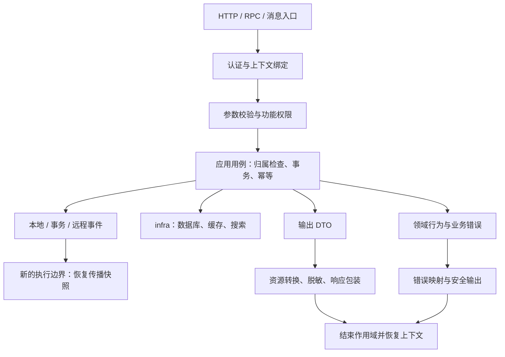

# Wuli3 业务开发实战教程

本教程按“创建项目 → HTTP 业务边界 → 错误与授权 → 数据读写和输出 → 跨执行边界协作”展开。基线为当前 `0.1.3-SNAPSHOT`、JDK 21、Spring Boot 3.5.15；版本不代表构件已发布到 Maven Central。

## 阅读路线

| 顺序 | 教程 | 重点解决的问题 |
| --- | --- | --- |
| 1 | [创建并运行项目](project.md) | 制品准备、生成与启动、CRUD 验证、七模块职责、已有项目接入 |
| 2 | [Web 业务服务](web.md) | 框架已做什么；业务必须补齐的认证、校验、用例、事务和返回契约 |
| 3 | [错误与权限](errors-permissions.md) | 错误码、HTTP 状态、权限目录、真实授权加载、注解与程序鉴权、缓存撤权 |
| 4 | [数据访问](data-access.md) | MySQL 分页闭环、Redis 缓存与锁、Elasticsearch/MongoDB CRUD 和分页 |
| 5 | [JSON、资源与脱敏](json.md) | Mapper 选择、资源路径双向转换、自定义策略、按权限展示原值及输出测试 |
| 6 | [上下文与事件](context-events.md) | 请求/异步/自定义上下文，本地/事务/远程事件，以及消息消费恢复上下文 |
| 按需 | [基础工具](utilities.md) | 断言、ID、可测试时钟、区间与金额集合工具 |
| 按需 | [其他扩展点](extensions.md) | 扩展注册方式、审计存储、优雅关闭与验收要点 |

已有项目可以直接从第一篇的 BOM 接入开始，无需先迁移为七模块。DDD 分层继续遵循 [DDD 约定](../ddd-conventions.md)，本教程在各例中标注代码归属，避免把框架适配放进领域模型。

## 一次业务操作怎样串起来

上下文负责携带已确认的调用信息，权限负责判断能否执行，领域负责规则，事件负责通知另一个执行者。传播身份不会代替认证，功能权限不会代替数据归属检查，事件发布成功也不等于数据库和消息已形成分布式事务。

## 示例怎么落地

- 全部配置以已导入 BOM 为前提；BOM 管版本，不自动引入组件。按章节选择依赖，不需要一次加入所有 starter。
- 标明文件路径的完整类可以按对应模块落地；Bean 方法、方法体片段需放到文中说明的宿主类。业务端口模板必须由应用实现，不能把测试夹具当生产实现。
- 同一能力的默认方式与替代实现是可选路线，例如默认资源解析器和自定义解析器；不要不加选择地同时复制。
- 图使用 Mermaid；支持 Mermaid 的 Markdown 阅读器可直接显示，其他阅读器仍可阅读相邻文字和表格。
- 数据访问示例说明连接前提和建表/索引步骤；真实中间件、认证服务和权限管理仍由应用部署与维护。

## 参考与验证

详细模块索引见 [guide 首页](../README.md)，完整目录示例见 [订单服务](../../examples/order-service/README.md)，发布消费验证见 [集成测试指南](../integration-tests.md)。

创建项目篇已经通过生成、打包和 HTTP 增删改查验证。各专题的验证范围见 [教程验证记录](verification.md)；源码核对、示例编译、模块单元测试和真实中间件测试分别记录，不混为同一种验证。
