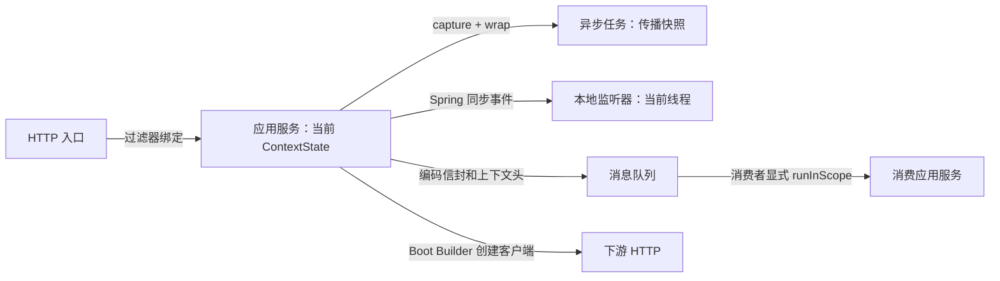
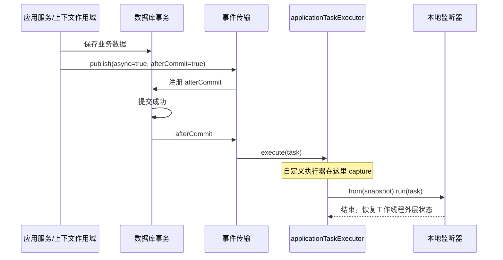

# 上下文与事件：把一次业务调用接起来

上下文回答“谁在什么调用中执行”，事件回答“发生了什么”。订单 ID、金额、业务发生时间应放进事件载荷；请求 ID、调用身份等横切信息放进上下文。事件即使脱离原请求，也应有足够的业务数据供消费者处理。

## 1. 先认识传播边界



| 类型 | 作用 | 什么时候用 |
| --- | --- | --- |
| `Context` | 当前作用域的不可变值 | 仅本地需要的数据，不进入常规捕获的传播快照 |
| `PropagationContext` | 声明允许传播的上下文 | 确有跨任务、跨协议需求的调用元数据 |
| `ContextState` | 当前执行的完整状态 | 建立作用域、在原状态上添加/删除一个上下文 |
| `ContextSnapshot` | 从完整状态捕获的传播项 | 在线程切换前捕获、在目标线程恢复 |
| `ContextManager` | 创建代理、捕获快照 | 控制执行边界，不提供永久的全局 `set` |
| `ContextPropagator` | 按显式 codec 白名单读写协议字段 | HTTP、MQ 等跨进程传播 |

上下文值及它引用的集合必须不可变；快照不会深拷贝业务对象。`ContextManager.capture()` 经 `ContextSnapshot.from(state)` 过滤本地项；不要手工用 `ContextSnapshot.of(...)` 塞入普通 `Context` 来绕过这一约定。

### 依赖与装配位置

BOM 已接入时，按需增加以下依赖。纯 Java 模块只要第一项；Web 应用通常已有第二项；使用本章 Wuli 事件发布器时增加第三项。

```kotlin
dependencies {
    implementation("com.kjs.wuli3:wuli3-context-propagation")
    implementation("com.kjs.wuli3:wuli3-web-spring-boot-starter")
    implementation("com.kjs.wuli3:wuli3-event-spring-boot-starter")
}
```

在七模块工程里，领域层只定义业务事实；上下文作用域、线程执行器和事件发送装配放在应用/适配器/启动边界，遵循生成工程的模块依赖规则。不要让聚合依赖 `HttpServletRequest`、MQ SDK 或线程池。

## 2. 读取、绑定与异步捕获

Web starter 自动提供 `ContextManager`、`ContextReader`、`ContextBinder`、两个 Accessor 和默认 `ContextPropagator`。业务服务优先注入只读 Accessor，只有需要建立边界的代码才注入 Manager。

```java
import com.kjs.wuli3.propagation.accessor.AuthContextAccessor;
import com.kjs.wuli3.propagation.accessor.InvocationContextAccessor;

// 在构造器中注入这两个 Bean。
final String requestId = this.invocationContextAccessor.requestId().orElse("no-request");
final String operator = this.authContextAccessor.principalId().orElse("anonymous");
```

`AuthContextAccessor.current()` 返回 `Optional<AuthContext>`，其中有主体类型、ID、名称和可空的权限主体码。不存在身份不能解释成“系统管理员”；需要身份的操作应进入统一鉴权链。`InvocationContext` 也不等于 OpenTelemetry 的 Trace/Span，不能假定 Wuli 上下文会自动携带所有第三方 ThreadLocal。

下面是无需 Spring、可直接运行的最小示例。它验证嵌套恢复和异步传播，执行完不需要手动 `clear()`。

```java
import com.kjs.wuli3.propagation.ContextManager;
import com.kjs.wuli3.propagation.context.ContextKey;
import com.kjs.wuli3.propagation.internal.InvocationContext;
import com.kjs.wuli3.propagation.store.ThreadLocalContextBackend;
import java.util.concurrent.Executors;

/** 演示作用域绑定、异步捕获与恢复。 */
public final class ContextExample {
    public static void main(final String[] args) throws Exception {
        final ThreadLocalContextBackend backend = new ThreadLocalContextBackend();
        final ContextManager manager = new ContextManager(backend, backend);
        final var key = ContextKey.of(InvocationContext.class);
        try (final var executor = Executors.newSingleThreadExecutor()) {
            manager.with(new InvocationContext("127.0.0.1", "request-001")).call(() -> {
                final var snapshot = manager.capture(); // 必须在提交任务之前捕获。
                final var future = executor.submit(manager.from(snapshot).wrapSupplier(
                        () -> manager.state().get(key).orElseThrow().requestId())::get);
                System.out.println(future.get()); // request-001
                manager.with(new InvocationContext("127.0.0.1", "nested")).run(() ->
                        System.out.println(manager.state().get(key).orElseThrow().requestId()));
                System.out.println(manager.state().get(key).orElseThrow().requestId()); // request-001
                return null;
            });
            System.out.println(manager.state().isEmpty()); // true
            System.out.println(executor.submit(() -> manager.state().isEmpty()).get()); // true
        }
    }
}
```

几条容易混淆的规则：

- `manager.with(contexts...)` 是替换完整状态，不隐式继承当前身份。要在当前状态添加租户，使用 `manager.with(manager.state().with(tenant)).run(task)`。
- `withCurrentState()` 保留完整状态，包含本地项；跨任务使用 `capture()` / `from(snapshot)`。
- `from(snapshot)` 不合并工作线程旧状态；回调正常结束或抛异常后恢复外层状态。
- 包装时捕获的值不会随提交者后续状态变化。不要在工作线程内部才调用 `capture()`。
- 传播上下文不传播数据库事务、锁、Servlet 请求对象或 MDC。尤其 Web 入口写的 MDC `requestId`，不会仅因恢复 `InvocationContext` 就自动出现在异步线程日志中。

### 纯消费者应用没有 Web starter 时

MQ starter 提供协议编码器，但不会凭空创建完整上下文后端。没有其他模块提供这些 Bean 时，在启动模块增加：

```java
import com.kjs.wuli3.propagation.ContextManager;
import com.kjs.wuli3.propagation.store.ThreadLocalContextBackend;
import org.springframework.context.annotation.Bean;
import org.springframework.context.annotation.Configuration;

@Configuration(proxyBeanMethods = false)
class ConsumerContextConfiguration {
    @Bean
    ThreadLocalContextBackend contextBackend() {
        return new ThreadLocalContextBackend();
    }

    @Bean
    ContextManager contextManager(final ThreadLocalContextBackend backend) {
        return new ContextManager(backend, backend);
    }
}
```

同一个后端同时实现 Reader/Binder，两者必须配套。需要 Accessor 时再以该 Reader 创建；不要另建一个独立后端，否则读取和绑定不在同一份状态上。

## 3. 自定义可传播上下文：租户示例

只有确实需要下游识别租户时才传播租户。业务请求中的租户参数必须先经过身份与租户归属检查，再建立上下文；codec 负责格式，不负责授权。

以下文件放在被生产者和消费者共同依赖的独立传播契约库，或先放各自的接入模块。生成工程的 `shared-kernel` 仅允许有限依赖，不能直接把依赖传播库的类型放进去绕过门禁。使用独立字段并限制字符范围，避免把任意对象和敏感数据塞进 Header。

```java
import com.kjs.wuli3.core.assertion.Asserts;
import com.kjs.wuli3.propagation.codec.ContextCodec;
import com.kjs.wuli3.propagation.context.ContextKey;
import com.kjs.wuli3.propagation.context.PropagationContext;
import java.util.Optional;
import java.util.Set;
import java.util.function.BiConsumer;
import java.util.function.Function;
import org.jspecify.annotations.Nullable;

/** 在可信调用边界传播已验证的租户标识。 */
public record TenantContext(String tenantId) implements PropagationContext {
    public static final ContextKey<TenantContext> KEY = ContextKey.of(TenantContext.class);
    private static final String FIELD = "X-Wuli3-Tenant-Id";
    private static final ContextCodec<TenantContext> CODEC = new Codec();

    public TenantContext {
        Asserts.whenNull(tenantId).throwIllegalArgumentException("tenantId 不能为空");
        Asserts.whenFalse(tenantId.matches("[A-Za-z0-9_-]{1,64}"))
                .throwIllegalArgumentException("tenantId 格式不正确");
    }

    @Override
    public ContextKey<TenantContext> contentKey() {
        return TenantContext.KEY;
    }

    @Override
    public ContextCodec<TenantContext> contentCodec() {
        return TenantContext.CODEC;
    }

    /** 编解码租户字段；缺失或不符合协议时不恢复租户。 */
    public static final class Codec implements ContextCodec<TenantContext> {
        @Override
        public ContextKey<TenantContext> contentKey() {
            return TenantContext.KEY;
        }

        @Override
        public Set<String> fieldNames() {
            return Set.of(TenantContext.FIELD);
        }

        @Override
        public void encode(final TenantContext context, final BiConsumer<String, String> writer) {
            writer.accept(TenantContext.FIELD, context.tenantId());
        }

        @Override
        public Optional<TenantContext> decode(final Function<String, @Nullable String> reader) {
            final String value = reader.apply(TenantContext.FIELD);
            return value == null || !value.matches("[A-Za-z0-9_-]{1,64}")
                    ? Optional.empty() : Optional.of(new TenantContext(value));
        }
    }
}
```

**实现 `contentCodec()` 或仅把 codec 声明为 Bean，都不会自动注册到协议白名单。** 在生产者和消费者的启动配置中显式替换 `ContextPropagator`，保留标准项：

```java
import com.kjs.wuli3.propagation.codec.ContextPropagator;
import org.springframework.context.annotation.Bean;
import org.springframework.context.annotation.Configuration;

@Configuration(proxyBeanMethods = false)
class PropagationConfiguration {
    @Bean
    ContextPropagator contextPropagator() {
        final var codecs = ContextPropagator.standardContextEncoder();
        codecs.add(new TenantContext.Codec());
        return new ContextPropagator(codecs);
    }
}
```

在已经校验租户归属的入口或应用服务中绑定，通用读取方式如下：

```java
final TenantContext tenant = new TenantContext(authorizedTenantId);
this.contextManager.with(this.contextManager.state().with(tenant)).run(() -> {
    final String currentTenant = this.contextManager.state()
            .get(TenantContext.KEY).orElseThrow().tenantId();
    // 在这里调用仓储、下游 HTTP 或发布消息。
});
```

对 MQ，已注册 codec 后，发送编码器和 `runInScope` 会使用它。对 HTTP，出站传播器也会编码它，但 **Web 入站过滤器只建立 Invocation/Auth，不会遍历所有 codec 自动绑定租户**。接收服务必须在可信认证之后、业务执行之前增加自己的入口作用域；不能仅加上述 Bean 就认为租户完成全链路传播。

## 4. Web 的自动部分与业务责任

默认 `ContextFilter` 在 Servlet 请求期间生成/解析请求 ID、解析来源 IP、建立 Invocation/Auth、设置响应请求 ID 与 MDC，并在结束时恢复上下文、移除 MDC。

```yaml
wuli3:
  web:
    context:
      enabled: true
      accept-external-request-id: true
      request-id-max-length: 128
      trusted-proxy-cidrs: [] # 默认不信任转发 IP；按实际入口网段配置。
```

认证是另一条信任边界：默认 `TrustedHttpAuthContextResolver` 假设网关已认证并清洗、重建认证头。`trusted-proxy-cidrs` 约束的是 IP 转发头，不是认证头授权开关。直接接公网的应用应实现 `AuthContextResolver`，验证自己的会话/令牌后创建 `AuthContext`，不要信任客户端自报身份。

出站 `RestClient` / `RestTemplate` 通过 Boot 的 Customizer 接入传播，使用容器提供的 Builder：

```java
import org.springframework.context.annotation.Bean;
import org.springframework.web.client.RestClient;

@Bean
RestClient inventoryClient(final RestClient.Builder builder) {
    return builder.baseUrl("http://inventory-service").build();
}
```

`RestClient.create()`、手工 `new RestTemplate()`、其他 HTTP 客户端、`CompletableFuture.commonPool()`、原生线程和任意 `@Async` 执行器均不能推定为自动接入。响应式流及 Servlet 异步分派也要单独设计边界。

## 5. 本地事件：先选择 Spring 原生还是统一信封

### 5.1 普通进程内协作，用 Spring 原生事件

定义不可变业务事实，应用服务注入 `org.springframework.context.ApplicationEventPublisher`，保存成功后调用：

```java
public record OrderPlaced(String orderId) {}

// 应用服务：在事务方法中完成领域操作与持久化后发布。
this.applicationEventPublisher.publishEvent(new OrderPlaced(orderId));
```

普通同步监听器跟随发布线程，因此可以读取当前上下文；监听器异常可能影响调用方事务。需要“业务事务提交后再更新外部系统”时：

```java
import org.springframework.stereotype.Component;
import org.springframework.transaction.event.TransactionPhase;
import org.springframework.transaction.event.TransactionalEventListener;

@Component
class OrderProjectionListener {
    @TransactionalEventListener(phase = TransactionPhase.AFTER_COMMIT)
    public void on(final OrderPlaced event) {
        // 更新缓存或投影；这里失败不能撤销已提交订单。
        // 若需写数据库，委托另一个 Bean 的 REQUIRES_NEW 事务方法。
    }
}
```

Spring 的 `@TransactionalEventListener` 默认在无事务时不执行；需要明确设置 `fallbackExecution = true` 才回退。它与下一节 Wuli `afterCommit` 在无事务时的行为不同。

### 5.2 需要统一信封/发布选项，用 Wuli EventPublisher

```java
import com.kjs.wuli3.event.EventPublisher;
import com.kjs.wuli3.event.envelope.EventEnvelopeTemplate;
import com.kjs.wuli3.event.options.SpringLocalPublishOptions;

// EventPublisher 通过构造器注入。
final var template = EventEnvelopeTemplate.of("order-events", "order.placed.v1");
final var envelope = template.wrap(new OrderPlaced(orderId));
this.eventPublisher.publish(new SpringLocalPublishOptions(false, true), envelope);
```

`topic` 是逻辑目标，`eventType` 是稳定契约名，`eventId` 是幂等标识，`occurredOn` 是创建信封的时间。重试同一事件应复用原信封/ID，不要每次 `wrap()` 重新生成。

当前路由没有 `LOCAL` / `REMOTE` 枚举开关：**实际发布选项的具体类型决定传输**。

| 选项 | 目标 | `async` | `afterCommit` |
| --- | --- | --- | --- |
| `SpringLocalPublishOptions` | Spring 应用事件 | 使用 `applicationTaskExecutor` | 支持 |
| `RabbitPublishOptions` | RabbitMQ | 编码后提交执行器 | 支持 |
| `RocketV4PublishOptions` | RocketMQ v4 | SDK 异步发送 | 支持 |
| `RocketV5PublishOptions` | RocketMQ v5 | SDK 异步发送 | 支持 |

没注册对应选项的 transport 会抛 `UnsupportedCapabilityException`；同时装 Rabbit/Rocket 不会自动广播。需要两路投递时显式发两次，并分别处理可靠性。

Wuli 本地发送的是 `EventEnvelope`，因此监听 `OrderPlaced` 不会收到它。可以显式检查载荷，避免依赖运行时泛型推断：

```java
import com.kjs.wuli3.event.envelope.EventEnvelope;
import org.springframework.context.event.EventListener;
import org.springframework.stereotype.Component;

@Component
class LocalEnvelopeListener {
    @EventListener
    public void on(final EventEnvelope<?> envelope) {
        if ("order.placed.v1".equals(envelope.eventType())
                && envelope.payload() instanceof OrderPlaced order) {
            System.out.println(order.orderId());
        }
    }
}
```

已经用 Wuli `afterCommit=true` 延迟发布的信封，使用普通 `@EventListener` 接收即可；不要再叠加事务监听来重复安排提交回调。

### 5.3 事务提交后 + 异步 + 上下文

Wuli 默认顺序是 `TransactionalEventTransport(AsyncEventTransport(local))`：先在原线程注册事务回调，再在提交后提交异步任务。



默认 `applicationTaskExecutor` 是未包装的 `VirtualThreadTaskExecutor`，**本地异步事件不会自动恢复 Wuli 上下文**。需要时提供同名 Bean，覆盖默认执行器：

```java
import com.kjs.wuli3.propagation.ContextManager;
import org.springframework.context.annotation.Bean;
import org.springframework.context.annotation.Configuration;
import org.springframework.core.task.TaskExecutor;
import org.springframework.core.task.VirtualThreadTaskExecutor;

@Configuration(proxyBeanMethods = false)
class EventExecutorConfiguration {
    @Bean("applicationTaskExecutor")
    TaskExecutor applicationTaskExecutor(final ContextManager contextManager) {
        final TaskExecutor delegate = new VirtualThreadTaskExecutor("business-event-");
        return task -> {
            final var snapshot = contextManager.capture();
            delegate.execute(contextManager.from(snapshot).wrap(task));
        };
    }
}
```

此配置服务于使用该执行器的任务；需要 `@Async` 时，另行开启 Spring 异步支持并明确 `@Async("applicationTaskExecutor")`。虚拟线程不提供业务限流，投影/外部接口有并发容量限制时应使用有容量控制的执行器，并在提交处同样包装。

**捕获时间很重要：**事务装饰器只保存信封数组，不在 `publish()` 时冻结上下文。`afterCommit=true` 时，在提交回调内才调用下层发送和执行器。确保所需作用域覆盖事务提交，例如入口 `contextManager.with(...).run(() -> transactionalService.place(...))`。若在事务方法内部临时绑定租户并立即退出，提交回调可能已读不到租户。需要不受作用域影响的持久业务信息应放入信封；可靠转发所需元数据应随 Outbox 一起保存。

## 6. 远程事件发送与消费恢复

### 6.1 RabbitMQ

增加 `com.kjs.wuli3:wuli3-rabbitmq-spring-boot-starter`；它包含 AMQP 与事件 starter。配置连接后由 Spring 提供 `RabbitTemplate`，Wuli 才注册 Rabbit transport。

```yaml
spring:
  rabbitmq:
    host: localhost
    port: 5672
    username: ${RABBIT_USERNAME}
    password: ${RABBIT_PASSWORD}
```

Wuli 将 `topic` 映射成 exchange，将 `eventType` 映射成 routing key；队列、exchange、绑定、死信和确认策略由业务/基础设施声明。例如在适配器配置声明：

```java
import org.springframework.amqp.core.BindingBuilder;
import org.springframework.amqp.core.Declarables;
import org.springframework.amqp.core.DirectExchange;
import org.springframework.amqp.core.Queue;
import org.springframework.context.annotation.Bean;

@Bean
Declarables orderTopology() {
    final DirectExchange exchange = new DirectExchange("order-events");
    final Queue queue = new Queue("order-projection", true);
    return new Declarables(exchange, queue,
            BindingBuilder.bind(queue).to(exchange).with("order.placed.v1"));
}
```

发送方法片段：

```java
import com.kjs.wuli3.event.envelope.EventEnvelopeTemplate;
import com.kjs.wuli3.rabbit.internal.RabbitPublishOptions;

final var envelope = EventEnvelopeTemplate.of("order-events", "order.placed.v1")
        .wrap(new OrderPlaced(orderId));
this.eventPublisher.publish(new RabbitPublishOptions().withAfterCommit(), envelope);
```

消息体是整个信封 JSON；传播上下文在 AMQP headers。消费端使用原始 `Message`，先恢复作用域，再反序列化并调用业务服务：

```java
import com.fasterxml.jackson.core.type.TypeReference;
import com.kjs.wuli3.core.assertion.Asserts;
import com.kjs.wuli3.event.envelope.EventEnvelope;
import com.kjs.wuli3.json.core.Jsons;
import com.kjs.wuli3.rabbit.internal.RabbitContextSupport;
import org.springframework.amqp.core.Message;
import org.springframework.amqp.rabbit.annotation.RabbitListener;
import org.springframework.stereotype.Component;

@Component
class OrderRabbitListener {
    private final RabbitContextSupport contexts;

    OrderRabbitListener(final RabbitContextSupport contexts) {
        this.contexts = contexts;
    }

    @RabbitListener(queues = "order-projection")
    public void on(final Message message) {
        this.contexts.runInScope(message.getMessageProperties().getHeaders(), () -> {
            final EventEnvelope<OrderPlaced> envelope = Jsons.fromJsonBytes(
                    message.getBody(), new TypeReference<EventEnvelope<OrderPlaced>>() {});
            Asserts.whenNull(envelope).throwIllegalArgumentException("事件不能为 null");
            Asserts.whenFalse("order.placed.v1".equals(envelope.eventType()))
                    .throwIllegalArgumentException("不支持的事件类型");
            // 用 envelope.eventId() 幂等处理，调用业务服务；成功后由容器确认。
            System.out.println(envelope.payload().orderId());
        });
    }
}
```

消费者使用 `Jsons` 时应显式依赖 `com.kjs.wuli3:wuli3-json`，不要依赖 starter 的实现依赖偶然可见。示例省略了幂等存储实现，不能把 `println` 当成完整投影服务。真实代码应在业务事务内原子完成“记录 eventId + 更新投影”，异常交给容器重试/死信策略；不要捕获失败后正常返回。

### 6.2 RocketMQ

增加 `com.kjs.wuli3:wuli3-rocketmq-spring-boot-starter`。v4 使用 `RocketMQTemplate`：

```yaml
rocketmq:
  name-server: localhost:9876
  producer:
    group: order-producer
```

```java
import com.kjs.wuli3.rocket.v4.RocketV4PublishOptions;

this.eventPublisher.publish(
        RocketV4PublishOptions.builder().afterCommit(true).build(), envelope);
```

v5 需额外显式引入 BOM 管理的 `org.apache.rocketmq:rocketmq-client-java`，并配置 Proxy endpoint；该 SDK 是 starter 的可选依赖。

```yaml
wuli3:
  rocketmq:
    v5:
      endpoints: localhost:8081
      topics: [order-events]
      request-timeout: 10s
      ssl-enabled: false # 与实际 Broker/Proxy 配置一致。
```

```java
import com.kjs.wuli3.rocket.v5.RocketV5PublishOptions;

this.eventPublisher.publish(
        RocketV5PublishOptions.builder().afterCommit(true).async(true).build(), envelope);
```

`topic` 对应 Rocket topic，`eventType` 对应 tag，`eventId` 对应 key。v4/v5 选项不可混用；需要相应客户端 Bean 才有路由。延迟、顺序发送还需匹配 Broker 能力，不能仅凭 Builder 接受参数就认为服务端支持。

v4 消费适配器可接收 `MessageExt` 保留原始属性：

```java
import com.kjs.wuli3.rocket.RocketContextSupport;
import org.apache.rocketmq.common.message.MessageExt;
import org.apache.rocketmq.spring.annotation.RocketMQMessageListener;
import org.apache.rocketmq.spring.core.RocketMQListener;
import org.springframework.stereotype.Component;

@Component
@RocketMQMessageListener(topic = "order-events", consumerGroup = "order-projection",
        selectorExpression = "order.placed.v1")
class OrderRocketListener implements RocketMQListener<MessageExt> {
    private final RocketContextSupport contexts;

    OrderRocketListener(final RocketContextSupport contexts) {
        this.contexts = contexts;
    }

    @Override
    public void onMessage(final MessageExt message) {
        this.contexts.runInScope(message.getProperties(), () -> {
            // message.getBody() 是信封 JSON；按 Rabbit 示例解码、验证、幂等处理。
        });
    }
}
```

v5 消费者由业务按原生 SDK 配置，使用 `MessageView.getProperties()` 作为 `runInScope` 的 headers，在作用域里处理消息。Wuli 不自动注册监听器、消费组或 ack 策略；`RocketContextSupport` / `RabbitContextSupport` 只恢复作用域，异常时也会恢复原状态，不吞掉业务失败。

### 6.3 哪些保证有，哪些需要自己补

| 场景 | 当前保证 | 业务仍需负责 |
| --- | --- | --- |
| 同步本地事件 | 默认在发布线程执行 | 监听异常是否允许影响主流程 |
| Wuli `afterCommit=true` | 活跃事务提交后执行；回滚不执行；无事务立即执行 | 不是数据库与 Broker 原子提交 |
| MQ 异步发送 | 编码在当前发送线程完成，再进入异步发送 | 完成失败监控、重试、补偿；提交任务不等于投递成功 |
| MQ 消费上下文 | 显式恢复调用期间，结束/异常后恢复外层 | 身份来源可信、权限过期策略、消费幂等 |
| `EventEnvelope` | 稳定的元数据结构 | 载荷版本演进、内容校验、重放策略 |

发送属于尽力而为。同步失败通常进入 `SendFailedException`；异步完成失败不能返回到已经结束的 HTTP 请求。Rabbit 异步失败记录日志，Rocket 可通过对应版本的 `sendCallback` 接管完成结果。Broker confirm、可恢复重试与告警仍需业务配置。

要求“订单保存后事件最终一定送达”时，采用业务事务内写 Outbox、独立投递、消费者 Inbox/唯一键去重。提交后进程崩溃、网络失败、重复投递、批量部分成功都不能靠 `afterCommit` 消除。Outbox 是应用设计，本 starter 不自动提供。

只从受控 Broker/内部入口恢复认证头；传播不等于签名验证。避免把密码、原始访问令牌、可变对象写入上下文。延迟消费时权限主体码可能已撤销或轮换，消费者必须按业务策略重新授权，或明确使用服务身份，而不是盲目信任历史请求权限。

## 7. 怎么验证已经接对

先在本地做不依赖 Broker 的测试：

1. 外层绑定请求 A，内层绑定 B；正常与异常退出后都恢复 A，最外层退出为空。
2. 同时提交 A/B 两个快照到同一个线程池；读到各自值，随后未包装任务读不到残留。
3. 普通 `Context` 不进入 `capture()`；自定义 `TenantContext` 能进入。使用自定义 propagator 做 `inject` 到 Map、`extract` 往返，验证字段缺失/非法值处理。
4. 事务提交才触发 `afterCommit`；回滚不触发；无事务时立即发送。再验证带租户作用域是否覆盖提交时刻。
5. 本地异步监听器读取请求 ID；分别用默认执行器与包装执行器验证，不要只测同步事件。
6. 模拟消息 headers，消费回调内能读上下文；回调抛异常后没有残留。

仓库相应检查命令：

```bash
./gradlew :wuli3-context-propagation:check \
  :wuli3-event-core:check :wuli3-event-spring-boot-starter:check \
  :wuli3-rocketmq-spring-boot-starter:check :wuli3-rabbitmq-spring-boot-starter:check
```

接真实 Broker 后再验证路由绑定、发送失败、重复消息、重试/死信、消费者重启与提交后进程中断。单元测试与源码核对不能代替这些环境验证。

本篇验证（2026-10-16）：以上五个模块的 `check` 通过（87 个任务，42 个执行、6 个缓存、39 个已最新）。9 个完整类示例与 `OrderPlaced` 使用仓库编译产物和缓存依赖通过 `javac -proc:none` 编译，纯 Java 上下文示例已运行并确认内外层恢复和线程清理。此编译不替代消费工程的 NullAway/Checkstyle 门禁；尚未连接真实 Broker 验证消息收发。

源码入口：[上下文核心](../../wuli3-context-propagation/src/main/java/com/kjs/wuli3/propagation/ContextManager.java)、[Web 自动配置](../../wuli3-web-spring-boot-starter/src/main/java/com/kjs/wuli3/web/autoconfigure/WebContextAutoConfiguration.java)、[事件自动配置](../../wuli3-event-spring-boot-starter/src/main/java/com/kjs/wuli3/event/autoconfigure/EventAutoConfiguration.java)。

[返回教程首页](README.md)
