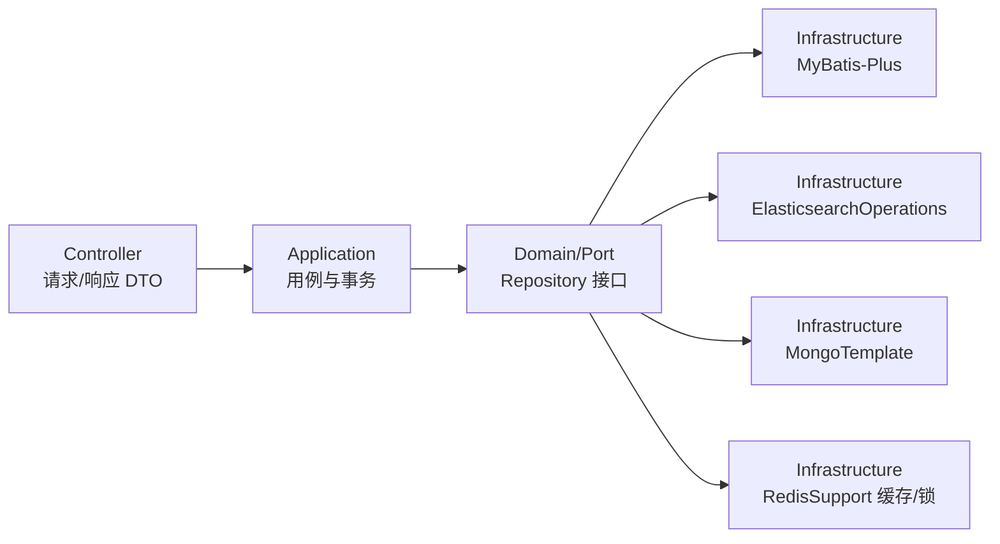
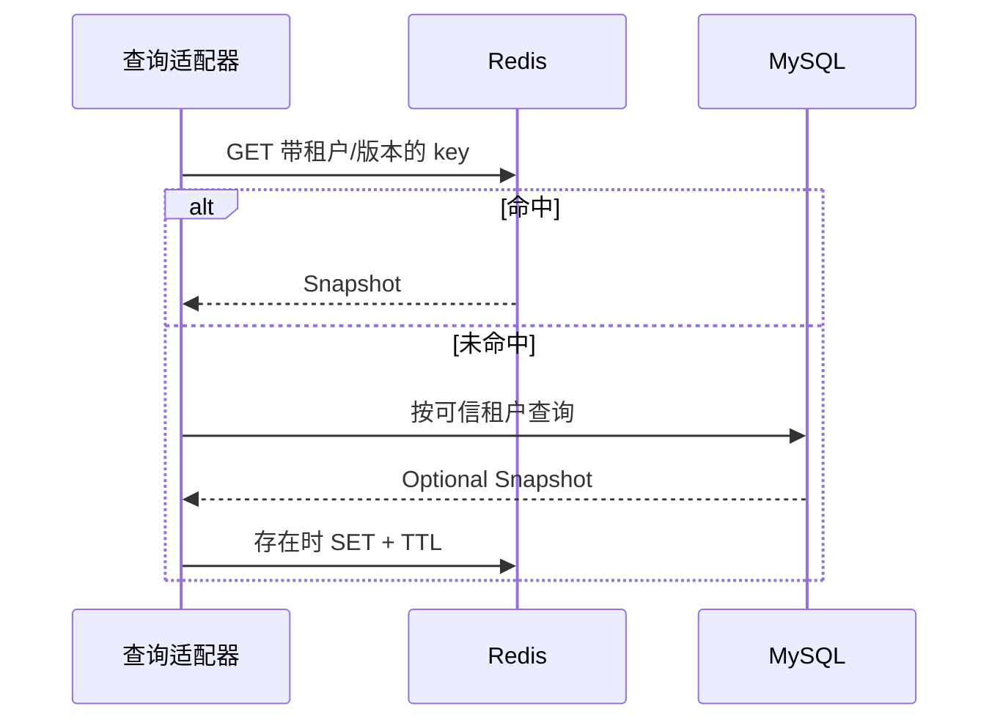
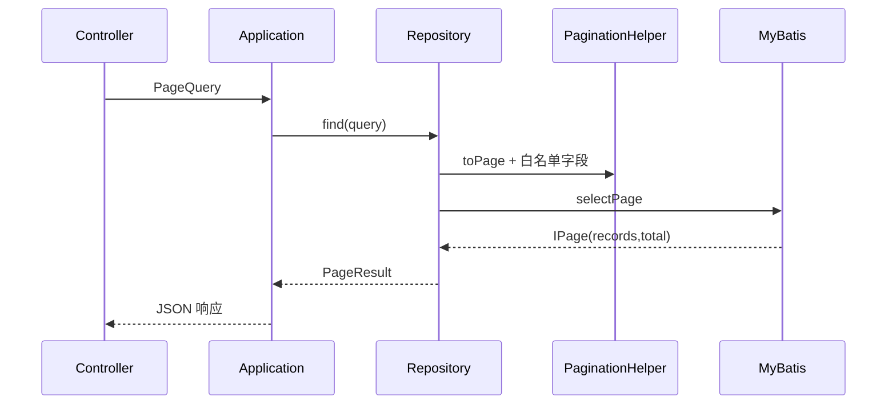

# 数据访问：Redis、MySQL 分页、Elasticsearch 与 MongoDB

本文按“连接配置 → Redis → MySQL 分页 → ES → MongoDB”展开。示例放在独立的演示包中，不依赖创建项目教程中的内存仓储。标明文件名的 Java 代码按文件保存；“方法内片段”需要放进已注入相应字段的基础设施类。

领域对象留在 `domain`，用例编排留在 `app`，数据库和缓存实现放在 `infra`。实体仓储接口通常由 domain 定义；列表搜索、报表等查询端口由 app 按用例定义。Controller 接收分页请求，查询端口返回 `PageResult`，业务层不暴露 MyBatis-Plus、Mongo `Query` 或 ES `Query`。



## 1. 依赖与连接

项目 BOM 当前锁定 Spring Boot `3.5.15`、Spring Data BOM `2025.0.12`，因此 Elasticsearch 为 Spring Data Elasticsearch `5.5.12`（Elasticsearch Java client `8.18.8`），MongoDB 为 Spring Data MongoDB `4.5.12`（Mongo driver `5.5.2`）。版本由 `wuli3-dependencies` 管理。以下假设已按 [创建项目](project.md) 导入 BOM，按需选择依赖，不必全部加入：

```kotlin
dependencies {
    implementation("com.kjs.wuli3:wuli3-redis-spring-boot-starter")
    implementation("com.kjs.wuli3:wuli3-mysql-spring-boot-starter")
    implementation("com.kjs.wuli3:wuli3-elasticsearch-spring-boot-starter")
    implementation("com.kjs.wuli3:wuli3-mongodb-spring-boot-starter")
    runtimeOnly("com.mysql:mysql-connector-j")
    // ES/Mongo 单独使用统一分页契约时显式加入；MySQL starter 已传递此模块。
    implementation("com.kjs.wuli3:wuli3-pagination")
}
```

```yaml
spring:
  application.name: order-service # RedisSupport 用它形成 order-service:<key>
  datasource:
    url: jdbc:mysql://localhost:3306/order
    username: order
    password: ${MYSQL_PASSWORD}
  data:
    redis:
      host: localhost
      port: 6379
    mongodb:
      uri: mongodb://localhost:27017/order
  elasticsearch:
    uris: ${ES_URIS:http://localhost:9200}
    username: ${ES_USERNAME:}
    password: ${ES_PASSWORD:}
```

这里只展示各连接属性的位置，配置文件也按实际使用的组件裁剪。MySQL starter 提供防护与观测，但数据源由 Spring Boot 根据应用配置装配，数据库及表由应用迁移脚本管理。ES starter 当前仅聚合依赖；Mongo starter 的 wuli3 自动配置入口为空。二者直接使用 Spring Boot 创建的 `ElasticsearchOperations`、`MongoTemplate`，没有额外的 wuli3 ES/Mongo 客户端 API。

示例 ES HTTP 地址只适用于本机已关闭安全认证的实验实例。实际 ES 8 环境应配置 HTTPS、凭据与受信任证书；不要通过关闭证书验证解决连接问题。

## 2. Redis：结构、TTL、缓存和锁

`RedisSupport` 聚合 `stringOperations()`、`objectOperations()`、`hashOperations()`、`setOperations()`。默认 `JsonRedisCodec` 使用项目 `Jsons` 编码对象；key 由 `spring.application.name` 自动加前缀，Hash field 与 Set member 不加前缀。

### 2.1 常用结构

以下是方法内片段，假设通过构造器注入了 `private final RedisSupport redisSupport`。String 与 Object 都使用 Redis String，但值编码不同，因此使用不同 key：

```java
import com.fasterxml.jackson.core.type.TypeReference;
import com.kjs.wuli3.redis.RedisKey;
import com.kjs.wuli3.redis.RedisSupport;
import java.time.Duration;
import java.util.List;
import java.util.Optional;
import java.util.Set;

final RedisKey tokenKey = RedisKey.expiring("session:demo", Duration.ofMinutes(30));
this.redisSupport.stringOperations().set(tokenKey, "demo-token");
final Optional<String> value = this.redisSupport.stringOperations().get(tokenKey);

final RedisKey recentKey = RedisKey.expiring("order:recent", Duration.ofMinutes(5));
this.redisSupport.objectOperations().set(recentKey, List.of("order-100", "order-101"));
final Optional<List<String>> ids = this.redisSupport.objectOperations().get(
        recentKey, new TypeReference<List<String>>() {});

final RedisKey status = RedisKey.expiring("order:status", Duration.ofHours(1));
this.redisSupport.hashOperations().put(status, "order-100", "PAID");
final Optional<String> state = this.redisSupport.hashOperations().get(status, "order-100", String.class);

final RedisKey pending = RedisKey.expiring("order:pending", Duration.ofHours(1));
this.redisSupport.setOperations().add(pending, "order-100", "order-101");
final Set<String> members = this.redisSupport.setOperations().members(pending, String.class);
this.redisSupport.setOperations().remove(pending, "order-100");
this.redisSupport.hashOperations().delete(status, "order-100");
this.redisSupport.delete(recentKey);
```

| 入口 | 适合的数据 | 关键约定 |
| --- | --- | --- |
| `stringOperations()` | Token、整数计数 | 原始 UTF-8 字符串；`increment(key, delta)` 对整数执行原子增量 |
| `objectOperations()` | DTO、列表、结构化缓存 | 默认 JSON；泛型容器读取用 `TypeReference<T>` |
| `hashOperations()` | 同一对象的多个独立字段 | field 是原始字符串，value 是 JSON |
| `setOperations()` | 去重 ID 集合 | member 是 JSON；对象去重取决于编码结果 |

String 写入的 `hello` 不是 JSON 字符串 `"hello"`，不能换成 Object 入口读取。同理，用原生 Redis 客户端向 Hash/Set 写数据时，应遵守 wuli3 的 JSON 编码。不要把 MVC 脱敏后的展示 DTO 当原始缓存模型；默认 Codec 使用 `Jsons`，不跟随 Spring MVC Mapper 定制。

`RedisKey.persistent(...)` 表示本次操作不指定 TTL；`RedisKey.expiring(...)` 的 TTL 至少为 1 ms。读取不存在的 String/Object/Hash field 返回 `Optional.empty()`，不存在的 Set 返回空集合。

| 操作 | TTL 行为 |
| --- | --- |
| String/Object `set` | 写入时一并设置 TTL；不带 TTL 的 `SET` 会覆盖原值并移除原 TTL |
| String/Object `setIfAbsent` | 仅首次写入设置 TTL；已有 key 不被续期 |
| String `increment` | 自增后另发命令续期；自增与续期合起来不原子 |
| Hash `put/putAll` | 写入后刷新整个 Hash 的 TTL；空 `putAll` 不续期 |
| Hash `putIfAbsent`、Set `add` | 实际新增时才续期；重复 Set member 不续期 |
| get、删除 field/member | 不刷新 TTL |
| `redisSupport.expire(key)` | 使用该 `RedisKey` 指定的 TTL 显式续期 |

Hash/Set 不指定 TTL 不会清掉已有过期时间。它们的“写成员 + 刷新 TTL”是两个命令；若业务需要整体原子性，应在基础设施层用 Lua 等原子机制实现。修改 `spring.application.name` 会改变物理 key 前缀，不会迁移旧缓存。

### 2.2 Cache-aside

缓存读取采用“命中直接返回，未命中加载数据库，再回填”。下面是可复用的基础设施组件：`OrderCache.java`。加载函数由调用方传入，表示已完成鉴权与数据范围过滤的查询；`tenantId` 必须来自可信身份。外部 ID 若允许 `:`，需要先定义无歧义的 key 编码。

```java
package com.example.data.redis;

import com.kjs.wuli3.core.assertion.Asserts;
import com.kjs.wuli3.redis.RedisKey;
import com.kjs.wuli3.redis.RedisSupport;
import java.time.Duration;
import java.util.Optional;
import java.util.function.Supplier;
import org.springframework.stereotype.Component;

/**
 * 缓存订单查询快照；数据授权和数据库加载由调用方负责。
 *
 * @author 国杨 create on 2026/10/16 10:00
 */
@Component
public final class OrderCache {
    private final RedisSupport redisSupport;

    public OrderCache(final RedisSupport redisSupport) {
        this.redisSupport = redisSupport;
    }

    /** 优先读缓存；数据库不存在时返回空值，不缓存空结果。 */
    public Optional<Snapshot> find(final String tenantId, final String id,
            final Supplier<Optional<Snapshot>> loader) {
        Asserts.whenNull(loader).throwIllegalArgumentException("加载函数不能为空");
        final RedisKey key = OrderCache.key(tenantId, id);
        final Optional<Snapshot> cached = this.redisSupport.objectOperations().get(key, Snapshot.class);
        if (cached.isPresent()) {
            return cached;
        }
        final Optional<Snapshot> loaded = loader.get();
        loaded.ifPresent(value -> this.redisSupport.objectOperations().set(key, value));
        return loaded;
    }

    /** 数据库提交成功后删除旧快照。 */
    public void invalidate(final String tenantId, final String id) {
        this.redisSupport.delete(OrderCache.key(tenantId, id));
    }

    /** 固定缓存版本、租户和业务标识的 key 结构。 */
    private static RedisKey key(final String tenantId, final String id) {
        Asserts.whenBlank(tenantId).throwIllegalArgumentException("租户不能为空");
        Asserts.whenBlank(id).throwIllegalArgumentException("订单 ID 不能为空");
        return RedisKey.expiring("order:view:v1:" + tenantId + ":" + id, Duration.ofMinutes(5));
    }

    /** 缓存模型只保存查询需要的稳定字段。 */
    public record Snapshot(String id, String status) {}
}
```



本例刻意不包含降级、空值缓存或并发合并：Redis 故障会向上传播，热点 key 过期可能同时回源。业务可根据缓存性质决定故障时查库、短 TTL 的显式“不存在”标记或同 key 回源锁。不要把所有反序列化错误都当缓存未命中，会掩盖数据格式不兼容。

更新时，在事务内发布失效事件，使用 `@TransactionalEventListener(phase = TransactionPhase.AFTER_COMMIT)` 调用 `invalidate`。回滚不会删除缓存；不要在提交前删除，其他线程可能读取旧库值并重新缓存。提交后删除仍有并发回填与进程崩溃窗口，需要可靠失效时使用 Outbox/可重试消息；TTL 只是兜底。

### 2.3 分布式锁

```java
import com.kjs.wuli3.redis.lock.RedisLock;
import com.kjs.wuli3.redis.lock.RedisLockExecutor;
import java.time.Duration;

final RedisLock lock = RedisLock.watchdog(
        "order-service:order:submit:" + orderId, Duration.ofSeconds(2));
this.redisLockExecutor.execute(lock, () -> {
    // 重新读取状态并执行幂等写入；锁不能替代唯一约束或事务。
});
```

片段假设已注入 `private final RedisLockExecutor redisLockExecutor`，`orderId` 是校验后的业务参数。锁任务在当前线程同步执行，不要把真正写入交给异步任务后立即结束回调。

`watchdog` 使用 Redisson 自动续期；能严格限定执行上限时使用 `RedisLock.fixedLease(key, wait, lease)`，租约到期可能允许其他持有者进入。`execute` 获取超时抛 `RedisLockAcquisitionException`；`tryExecute(lock, Runnable)` 返回是否执行，Supplier 重载返回 `Optional<T>`，任务不要返回 null。锁 key 不自动加服务前缀，上例已显式包含；多租户还应加入租户维度。

事务必须在释放锁前完成。例如锁回调中调用另一个 Bean 的 `@Transactional` 方法，待它提交并返回后释放；若在外层事务中调用锁，可能先解锁再提交。数据库唯一约束、状态校验和幂等键仍是最终数据保证。

自动配置默认启用：存在 `RedisConnectionFactory` 时提供 `RedisSupport`，存在 `RedissonClient` 时提供锁执行器。可通过 `wuli3.redis.operations.enabled=false`、`wuli3.redis.lock.enabled=false` 关闭对应能力。自定义 `RedisCodec` Bean 可替换编码策略，但 `RedisSupport` 创建自己的模板，不读取应用其他 `RedisTemplate` 的序列化设置；替换 Codec 要同时考虑已有数据兼容和 key 前缀规则。

## 3. MySQL 分页：从请求到 SQL 再回到响应

### 3.1 应用契约

`PageQuery` 页码从 1 开始，页大小为 1～200，`sorts` 顺序表示优先级；`PageResult.items` 是不可变列表。

```java
import com.kjs.wuli3.pagination.PageQuery;
import com.kjs.wuli3.pagination.Sort;
import com.kjs.wuli3.pagination.SortDirection;
import java.util.List;

final PageQuery query = new PageQuery(1, 20,
        List.of(new Sort("createdAt", SortDirection.DESC)));
```

应用查询端口示例（`OrderQueryRepository.java`），不返回持久化实体。生成工程的 DDD 规则只允许 infra 按约定引用 app 的查询契约：端口以 `QueryRepository` 结尾，查询条件以 `Query` 结尾，结果以 `DTO` 结尾。投影使用独立顶层类型，避免内部类名称破坏后缀判断。框架不会替你生成具体查询接口：

```java
package com.example.order.app.repository.order;

import com.kjs.wuli3.pagination.PageQuery;
import com.kjs.wuli3.pagination.PageResult;

/**
 * 提供订单列表用例需要的分页读取能力。
 *
 * @author 国杨 create on 2026/10/16 10:00
 */
public interface OrderQueryRepository {
    /** 按固定的已支付状态查询；调用方负责访问授权。 */
    PageResult<OrderSummaryDTO> findPaid(PageQuery query);
}
```

`OrderSummaryDTO.java` 与端口放在同一 app 查询契约包：

```java
package com.example.order.app.repository.order;

import java.time.LocalDateTime;

/**
 * 对外提供订单列表需要的字段，隔离数据库行模型。
 *
 * @author 国杨 create on 2026/10/16 10:00
 */
public record OrderSummaryDTO(long id, String status, LocalDateTime createdAt) {}
```

### 3.2 基础设施配置

starter 默认提供全表更新/删除防护，但不会自动启用分页；注册 MyBatis-Plus 的分页拦截器：

```java
package com.example.order.infra.config;

import com.baomidou.mybatisplus.annotation.DbType;
import com.baomidou.mybatisplus.extension.plugins.inner.PaginationInnerInterceptor;
import com.example.order.infra.persistence.order.OrderMapper;
import org.mybatis.spring.annotation.MapperScan;
import org.springframework.context.annotation.Bean;
import org.springframework.context.annotation.Configuration;
import org.springframework.core.Ordered;
import org.springframework.core.annotation.Order;

/**
 * 配置演示订单 Mapper 扫描及分页 SQL 拦截器。
 *
 * @author 国杨 create on 2026/10/16 10:00
 */
@Configuration(proxyBeanMethods = false)
@MapperScan(basePackageClasses = OrderMapper.class)
public class OrderMysqlConfiguration {
    /** 将分页排在常规内部拦截器之后。 */
    @Bean
    @Order(Ordered.LOWEST_PRECEDENCE)
    PaginationInnerInterceptor paginationInnerInterceptor() {
        return new PaginationInnerInterceptor(DbType.MYSQL);
    }
}
```

文件名为 `OrderMysqlConfiguration.java`。MyBatis-Plus 自动配置会收集 `InnerInterceptor` Bean；wuli3 提供默认 BlockAttack 拦截器。若其他自定义拦截器也使用最低优先级，须明确它们的顺序，确保分页最后执行。应用自行声明 `MybatisPlusInterceptor` 时自动聚合让出，需自行加入分页和需要保留的防护插件。

本节使用以下表结构，放进业务工程采用的数据库迁移脚本中执行。示例无多租户字段；多租户工程必须补充可信租户过滤和对应索引：

```sql
CREATE TABLE demo_order (
    id BIGINT PRIMARY KEY,
    status VARCHAR(20) NOT NULL,
    created_at DATETIME(6) NOT NULL,
    INDEX idx_order_status_created (status, created_at, id)
);

INSERT INTO demo_order(id, status, created_at) VALUES
    (101, 'PAID', '2026-10-16 10:00:00'),
    (102, 'PAID', '2026-10-16 10:00:00'),
    (103, 'NEW',  '2026-10-16 11:00:00');
```

`OrderRow.java`：基础设施行模型。这里用公开字段减少映射样板，字段保留可写是为了 MyBatis 反射绑定；它不承担领域约束，也不直接作为 HTTP DTO。

```java
package com.example.order.infra.persistence.order;

import com.baomidou.mybatisplus.annotation.TableId;
import com.baomidou.mybatisplus.annotation.TableName;
import java.time.LocalDateTime;

/**
 * 映射演示订单表，由 MyBatis 填充字段。
 *
 * @author 国杨 create on 2026/10/16 10:00
 */
@TableName("demo_order")
public final class OrderRow {
    @TableId
    public Long id;
    public String status;
    public LocalDateTime createdAt;
}
```

`OrderMapper.java`：`BaseMapper` 已提供 `selectPage`，本例无需 XML。

```java
package com.example.order.infra.persistence.order;

import com.baomidou.mybatisplus.core.mapper.BaseMapper;

/**
 * 提供演示订单表的 MyBatis-Plus 数据访问。
 *
 * @author 国杨 create on 2026/10/16 10:00
 */
public interface OrderMapper extends BaseMapper<OrderRow> {}
```

### 3.3 Repository 适配器与排序白名单

`MysqlOrderQueryRepository.java` 实现前面的应用端口。白名单验证字段，缺少排序时提供默认顺序；追加唯一 ID 作为同值排序的决胜字段，避免翻页顺序不确定：

```java
package com.example.order.infra.persistence.order;

import com.baomidou.mybatisplus.core.conditions.query.QueryWrapper;
import com.baomidou.mybatisplus.core.metadata.OrderItem;
import com.baomidou.mybatisplus.extension.plugins.pagination.Page;
import com.example.order.app.repository.order.OrderQueryRepository;
import com.example.order.app.repository.order.OrderSummaryDTO;
import com.kjs.wuli3.core.assertion.Asserts;
import com.kjs.wuli3.core.error.ErrorCodeException;
import com.kjs.wuli3.core.error.builtin.CommonErrors;
import com.kjs.wuli3.mysql.pagination.PaginationHelper;
import com.kjs.wuli3.pagination.PageQuery;
import com.kjs.wuli3.pagination.PageResult;
import org.springframework.stereotype.Repository;

/**
 * 在 MySQL 查询与应用分页契约之间完成转换。
 *
 * @author 国杨 create on 2026/10/16 10:00
 */
@Repository
public final class MysqlOrderQueryRepository implements OrderQueryRepository {
    private final OrderMapper mapper;

    public MysqlOrderQueryRepository(final OrderMapper mapper) {
        this.mapper = mapper;
    }

    /** 查询已支付订单，将数据库实体转成列表 DTO。 */
    @Override
    public PageResult<OrderSummaryDTO> findPaid(final PageQuery query) {
        Asserts.whenNull(query).throwIllegalArgumentException("分页条件不能为空");
        final Page<OrderRow> page = PaginationHelper.toPage(query, MysqlOrderQueryRepository::column);
        if (query.sorts().isEmpty()) {
            page.addOrder(OrderItem.desc("created_at"));
        }
        if (query.sorts().stream().noneMatch(sort -> "id".equals(sort.field()))) {
            page.addOrder(OrderItem.desc("id"));
        }
        final QueryWrapper<OrderRow> filter = new QueryWrapper<OrderRow>().eq("status", "PAID");
        final Page<OrderRow> selected = this.mapper.selectPage(page, filter);
        return PaginationHelper.toPageResult(selected,
                row -> new OrderSummaryDTO(row.id, row.status, row.createdAt));
    }

    /** 外部排序字段只映射到确定的 SQL 列名。 */
    private static String column(final String field) {
        return switch (field) {
            case "id" -> "id";
            case "createdAt" -> "created_at";
            default -> throw new ErrorCodeException(CommonErrors.ILLEGAL_ARGUMENT, "不支持的排序字段：" + field);
        };
    }
}
```

请求字段只允许映射到固定数据库列名，不能拼接 `ORDER BY`，也不能对请求使用不带映射函数的 `PaginationHelper.toPage(query)`，那个重载会原样使用字段。

`OrderPageService.java` 保留应用用例边界，后续的数据范围、审计和查询组合在这一层组织：

```java
package com.example.order.app.service.order;

import com.example.order.app.repository.order.OrderQueryRepository;
import com.example.order.app.repository.order.OrderSummaryDTO;
import com.kjs.wuli3.core.assertion.Asserts;
import com.kjs.wuli3.pagination.PageQuery;
import com.kjs.wuli3.pagination.PageResult;
import org.springframework.stereotype.Service;

/**
 * 编排订单分页用例，依赖查询端口而非持久化实现。
 *
 * @author 国杨 create on 2026/10/16 10:00
 */
@Service
public final class OrderPageService {
    private final OrderQueryRepository repository;

    public OrderPageService(final OrderQueryRepository repository) {
        this.repository = repository;
    }

    /** 查询已支付订单分页，供入口适配器调用。 */
    public PageResult<OrderSummaryDTO> findPaid(final PageQuery query) {
        Asserts.whenNull(query).throwIllegalArgumentException("分页条件不能为空");
        return this.repository.findPaid(query);
    }
}
```

`OrderPageApi.java` 放在 adapter 层，调用 app 用例服务，不直接调用查询仓储。本例依赖 Web starter，实际项目须在端点补上自己的权限约束：

```java
package com.example.order.adapter.api.order;

import com.example.order.app.repository.order.OrderSummaryDTO;
import com.example.order.app.service.order.OrderPageService;
import com.kjs.wuli3.pagination.PageQuery;
import com.kjs.wuli3.pagination.PageResult;
import org.springframework.web.bind.annotation.PostMapping;
import org.springframework.web.bind.annotation.RequestBody;
import org.springframework.web.bind.annotation.RequestMapping;
import org.springframework.web.bind.annotation.RestController;

/**
 * 接收订单列表请求，返回与持久化框架无关的分页结果。
 *
 * @author 国杨 create on 2026/10/16 10:00
 */
@RestController
@RequestMapping("/demo/orders")
public final class OrderPageApi {
    private final OrderPageService service;

    public OrderPageApi(final OrderPageService service) {
        this.service = service;
    }

    /** 分页查询已支付订单。 */
    @PostMapping("/page")
    public PageResult<OrderSummaryDTO> page(@RequestBody final PageQuery query) {
        return this.service.findPaid(query);
    }
}
```

```bash
curl -X POST http://localhost:8080/demo/orders/page \
  -H 'Content-Type: application/json' \
  -d '{"pageNumber":1,"pageSize":1,"sorts":[{"field":"createdAt","direction":"DESC"}]}'
```

使用前面的测试数据，分页负载中的 `total` 为 2、`items` 只有 ID 102，`pageNumber` 为 1、`pageSize` 为 1。业务使用统一 Web 响应封装时该分页对象位于响应 `data` 内。分页拦截器负责 COUNT 与分页 SQL，`PaginationHelper` 本身不执行 SQL。



## 4. Elasticsearch：文档映射、CRUD 与分页

ES 适合订单搜索投影。订单事务仍落在事实存储中；提交后通过可重试事件更新搜索文档，搜索结果允许一定延迟。ES starter 不会自动把 MySQL 行同步到索引。

### 4.1 定义搜索文档

`OrderDocument.java`：把 ID 再存入 keyword 字段 `orderId`，用于稳定排序；不要直接按 ES 的 `_id` 排序。record 是持久化查询模型，不是可变领域聚合。

```java
package com.example.data.es;

import java.time.Instant;
import org.springframework.data.annotation.Id;
import org.springframework.data.elasticsearch.annotations.DateFormat;
import org.springframework.data.elasticsearch.annotations.Document;
import org.springframework.data.elasticsearch.annotations.Field;
import org.springframework.data.elasticsearch.annotations.FieldType;

/**
 * 保存订单搜索投影及其明确的 ES 字段类型。
 *
 * @author 国杨 create on 2026/10/16 10:00
 */
@Document(indexName = "demo-orders-v1", createIndex = false)
public record OrderDocument(
        @Id String id,
        @Field(type = FieldType.Keyword) String orderId,
        @Field(type = FieldType.Keyword) String status,
        @Field(type = FieldType.Text) String title,
        @Field(type = FieldType.Date, format = DateFormat.date_time) Instant createdAt) {}
```

`Keyword` 用于精确过滤和排序；`Text` 用于分词全文检索，中文分词需要根据部署环境配置分析器。`Instant` 与显式日期格式对应，不把所有字段都当字符串存储。

### 4.2 首次创建索引与 CRUD

以下方法内片段假设构造器注入 `private final ElasticsearchOperations operations`。只在开发初始化或受控迁移中创建索引；普通业务请求不执行建索引操作：

```java
import java.time.Instant;
import java.util.Optional;
import org.springframework.data.elasticsearch.core.ElasticsearchOperations;
import org.springframework.data.elasticsearch.core.IndexOperations;

final IndexOperations index = this.operations.indexOps(OrderDocument.class);
if (!index.exists()) {
    index.createWithMapping();
}

final OrderDocument saved = this.operations.save(new OrderDocument(
        "order-101", "order-101", "PAID", "蓝牙耳机", Instant.parse("2026-10-16T02:00:00Z")));
final Optional<OrderDocument> found = Optional.ofNullable(this.operations.get(saved.id(), OrderDocument.class));

// 同 ID 再次保存用于更新整份投影；需要保留的字段必须全部提供。
this.operations.save(new OrderDocument(saved.id(), saved.orderId(), "SHIPPED", saved.title(), saved.createdAt()));
this.operations.delete(saved.id(), OrderDocument.class);
```

`ElasticsearchOperations` 不会自动执行注解中的索引创建与映射管理。`exists → create` 也不是跨实例原子操作，生产由单独迁移流程维护版本索引及别名。字段类型变更通常需要新索引、重建数据并切换别名；重新部署类定义不会修改已有数据的类型。

### 4.3 搜索并转换为统一分页

`OrderSearch.java` 使用固定排序，主动拒绝请求自定义排序，避免“收了参数却悄悄忽略”。复杂条件可改用 `NativeQuery`，但仍由适配器构造查询，不接收客户端传入的任意 JSON DSL。

```java
package com.example.data.es;

import com.kjs.wuli3.core.assertion.Asserts;
import com.kjs.wuli3.pagination.PageQuery;
import com.kjs.wuli3.pagination.PageResult;
import java.util.List;
import org.springframework.data.domain.PageRequest;
import org.springframework.data.domain.Sort;
import org.springframework.data.elasticsearch.core.ElasticsearchOperations;
import org.springframework.data.elasticsearch.core.SearchHit;
import org.springframework.data.elasticsearch.core.SearchHits;
import org.springframework.data.elasticsearch.core.query.Criteria;
import org.springframework.data.elasticsearch.core.query.CriteriaQuery;
import org.springframework.stereotype.Repository;

/**
 * 演示从 ES 读取已支付订单的固定顺序分页。
 *
 * @author 国杨 create on 2026/10/16 10:00
 */
@Repository
public final class OrderSearch {
    private final ElasticsearchOperations operations;

    public OrderSearch(final ElasticsearchOperations operations) {
        this.operations = operations;
    }

    /** 精确过滤状态并返回完整命中总数；仅支持默认 10000 条结果窗口。 */
    public PageResult<OrderDocument> findPaid(final PageQuery request) {
        Asserts.whenNull(request).throwIllegalArgumentException("分页条件不能为空");
        Asserts.whenFalse(request.sorts().isEmpty()).throwIllegalArgumentException("当前搜索仅支持固定排序");
        Asserts.whenTrue((long) request.pageNumber() * request.pageSize() > 10_000L)
                .throwIllegalArgumentException("搜索页超出结果窗口，请使用游标查询");
        final PageRequest pageable = PageRequest.of(request.pageNumber() - 1, request.pageSize(),
                Sort.by(Sort.Order.desc("createdAt"), Sort.Order.desc("orderId")));
        final CriteriaQuery query = new CriteriaQuery(new Criteria("status").is("PAID"), pageable);
        query.setTrackTotalHits(true);
        final SearchHits<OrderDocument> hits = this.operations.search(query, OrderDocument.class);
        final List<OrderDocument> items = hits.getSearchHits().stream().map(SearchHit::getContent).toList();
        return new PageResult<>(items, hits.getTotalHits(), request.pageNumber(), request.pageSize());
    }
}
```

本类为基础设施示例，真实应用在返回 application 前将 `OrderDocument` 映射为查询 DTO，并实现自己的查询端口。要搜索标题，可组合 `new Criteria("title").matches(keyword)`；这会按字段分析器分词，不等同于字符串 `contains`。多租户查询还必须增加可信租户条件，不能只靠 Controller 限制入口。

Spring Data `PageRequest` 从 0 开始，转换使用 `pageNumber - 1`。`setTrackTotalHits(true)` 请求精确总数，否则超过 ES 跟踪阈值时 `getTotalHits()` 可能只是下界。精确计数有额外成本；如果界面只需“还有下一页”，应设计游标结果而不是强行返回精确 `PageResult.total`。深分页使用 PIT + `search_after` 等方案，不能只调大 `pageSize`。

搜索可见性受 refresh 影响，按 ID get 成功不代表搜索马上命中。测试可在写入后显式 `operations.indexOps(OrderDocument.class).refresh()` 再断言搜索；业务逐条写入时不要机械强制刷新。

## 5. MongoDB：MongoTemplate、映射与分页

### 5.1 保存订单扩展文档

Mongo 适合有嵌套结构的文档。本例用显式字符串 ID，与关系库订单关联；如果使用自动生成 ID，应使用保存操作返回的新对象。`OrderMongo.java`：

```java
package com.example.data.mongo;

import java.time.Instant;
import java.util.Map;
import org.springframework.data.annotation.Id;
import org.springframework.data.mongodb.core.mapping.Document;

/**
 * 保存订单状态及扩展属性的 Mongo 文档。
 *
 * @author 国杨 create on 2026/10/16 10:00
 */
@Document("demo_orders")
public record OrderMongo(@Id String id, String status, Instant createdAt, Map<String, String> attributes) {}
```

以下是方法内片段，假设构造器已注入 `private final MongoTemplate mongoTemplate`，位于同一演示包：

```java
import com.mongodb.client.result.UpdateResult;
import java.time.Instant;
import java.util.Map;
import java.util.Optional;
import org.springframework.data.mongodb.core.MongoTemplate;
import org.springframework.data.mongodb.core.query.Criteria;
import org.springframework.data.mongodb.core.query.Query;
import org.springframework.data.mongodb.core.query.Update;

final OrderMongo created = this.mongoTemplate.insert(new OrderMongo(
        "order-101", "NEW", Instant.parse("2026-10-16T02:00:00Z"), Map.of("channel", "APP")));
final Optional<OrderMongo> found = Optional.ofNullable(
        this.mongoTemplate.findById(created.id(), OrderMongo.class));

final Query expectedState = Query.query(Criteria.where("id").is(created.id()).and("status").is("NEW"));
final UpdateResult result = this.mongoTemplate.updateFirst(
        expectedState, new Update().set("status", "PAID"), OrderMongo.class);
final boolean changed = result.getModifiedCount() == 1L;

this.mongoTemplate.remove(Query.query(Criteria.where("id").is(created.id())), OrderMongo.class);
```

`insert` 在 ID 已存在时失败；`save` 按 ID 保存或替换整份文档，适合明确的整文档覆盖。仅修改状态时使用 `updateFirst + $set`，并在查询中带上预期旧状态；修改数为 0 表示未找到符合状态的文档，业务决定报不存在、状态冲突还是幂等成功。`remove` 的条件可能匹配多条，按 ID 删除时明确填写 ID；不要把空查询传给删除。

### 5.2 分页与准确总数

`MongoOrderQueries.java`：count 与分页查询创建独立的 `Query`，总数不会带上分页窗口；固定 `createdAt + id` 排序，页码同样减 1。

```java
package com.example.data.mongo;

import com.kjs.wuli3.core.assertion.Asserts;
import com.kjs.wuli3.pagination.PageQuery;
import com.kjs.wuli3.pagination.PageResult;
import java.util.List;
import org.springframework.data.domain.PageRequest;
import org.springframework.data.domain.Sort;
import org.springframework.data.mongodb.core.MongoTemplate;
import org.springframework.data.mongodb.core.query.Criteria;
import org.springframework.data.mongodb.core.query.Query;
import org.springframework.stereotype.Repository;

/**
 * 演示独立计数和固定排序的 Mongo 文档分页。
 *
 * @author 国杨 create on 2026/10/16 10:00
 */
@Repository
public final class MongoOrderQueries {
    private final MongoTemplate mongoTemplate;

    public MongoOrderQueries(final MongoTemplate mongoTemplate) {
        this.mongoTemplate = mongoTemplate;
    }

    /** 分页读取已支付订单；count 与当前页为两次独立读取。 */
    public PageResult<OrderMongo> findPaid(final PageQuery request) {
        Asserts.whenNull(request).throwIllegalArgumentException("分页条件不能为空");
        Asserts.whenFalse(request.sorts().isEmpty()).throwIllegalArgumentException("当前查询仅支持固定排序");
        final Query countQuery = Query.query(Criteria.where("status").is("PAID"));
        final long total = this.mongoTemplate.count(countQuery, OrderMongo.class);
        final PageRequest pageable = PageRequest.of(request.pageNumber() - 1, request.pageSize(),
                Sort.by(Sort.Order.desc("createdAt"), Sort.Order.desc("id")));
        final Query pageQuery = Query.query(Criteria.where("status").is("PAID")).with(pageable);
        final List<OrderMongo> items = this.mongoTemplate.find(pageQuery, OrderMongo.class);
        return new PageResult<>(items, total, request.pageNumber(), request.pageSize());
    }
}
```

Mongo count 会考虑 Query 的 `skip/limit`，因此不要用已经分页的 Query 再求总数。count 和 find 是两次读取，并发写入时可能看到不同时间点的数据；接口如要求严格快照语义，需要另行明确读一致性和事务策略。普通大页码会增加跳过数据的成本，大数据浏览宜改为按排序键游标查询。

### 5.3 建索引与事务边界

为本例的查询建立复合索引。以下仍是基础设施方法内片段，放到受控初始化或迁移步骤：

```java
import org.springframework.data.domain.Sort;
import org.springframework.data.mongodb.core.index.Index;

this.mongoTemplate.indexOps(OrderMongo.class).createIndex(new Index()
        .on("status", Sort.Direction.ASC)
        .on("createdAt", Sort.Direction.DESC)
        .on("id", Sort.Direction.DESC));
```

实体索引操作会把 Java 的 `id` 映射为 Mongo `_id`。本例使用 4.5 新增的 `createIndex`；旧资料里的 `ensureIndex` 在 4.5 已废弃。Spring Data 自动建索引默认关闭，只写 `@Indexed` 并不意味着已有数据库会自动完成迁移。多租户版本应把租户条件与索引一起设计。

Mongo 单文档更新具有原子性；多文档事务需要可用的 Mongo 事务部署环境及应用配置的 `MongoTransactionManager`，并明确使用对应事务管理器。仅加 `@Transactional` 不会让 MySQL 和 Mongo 成为同一事务；跨存储投影更新用事件、重试和幂等保障。

ES/Mongo 均可改用 Spring Data Repository，但这属于基础设施接口。若同一服务启用多个 Spring Data 模块，应使用各自专属 Repository 基类、正确实体注解和独立扫描包，避免模糊的仓储识别。

## 6. 官方依据与版本边界

- [Spring Data BOM 2025.0.12](https://repo.maven.apache.org/maven2/org/springframework/data/spring-data-bom/2025.0.12/spring-data-bom-2025.0.12.pom)：ES 5.5.12、Mongo 4.5.12 的版本清单。
- [Spring Boot 3.5 NoSQL](https://docs.spring.io/spring-boot/3.5/reference/data/nosql.html)：`spring.data.mongodb.*`、`spring.elasticsearch.*` 属性以及 `MongoTemplate`/ES 自动配置。
- [Spring Data Elasticsearch 5.5 版本矩阵](https://docs.spring.io/spring-data/elasticsearch/reference/5.5/elasticsearch/versions.html)：5.5.x 对应的 ES 8.18.8 基线；部署版本需与所用客户端一起验证。
- [Spring Data Elasticsearch 5.5 Operations](https://docs.spring.io/spring-data/elasticsearch/reference/5.5/elasticsearch/template.html)：`ElasticsearchOperations`、`CriteriaQuery`、分页与 index operations。
- [Spring Data Elasticsearch 5.5 Mapping](https://docs.spring.io/spring-data/elasticsearch/reference/5.5/elasticsearch/object-mapping.html)：`@Document`、`@Field`、`@Id` 映射。
- [Spring Data MongoDB 4.5 Template CRUD](https://docs.spring.io/spring-data/mongodb/reference/4.5/mongodb/template-crud-operations.html)：`MongoTemplate` 保存、更新、删除。
- [Spring Data MongoDB 4.5 Query](https://docs.spring.io/spring-data/mongodb/reference/4.5/mongodb/template-query-operations.html)：`Query`、`Criteria`、分页与 count 语义。
- [Spring Data MongoDB 4.5 Indexes](https://docs.spring.io/spring-data/mongodb/reference/4.5/mongodb/mapping/mapping-index-management.html)：自动建索引默认关闭及显式索引管理。
- [Mongo IndexOperations 4.5 API](https://docs.spring.io/spring-data/mongodb/docs/4.5.x/api/org/springframework/data/mongodb/core/index/IndexOperations.html)：`createIndex` 与 `ensureIndex` 的废弃状态。
- [MongoOperations 4.5 API](https://docs.spring.io/spring-data/mongodb/docs/4.5.x/api/org/springframework/data/mongodb/core/MongoOperations.html)：count 会受 Query 的 skip/limit 影响。

核对日期：2026-10-16。官方文档固定在 3.5/5.5/4.5 版本线，与当前 BOM 对齐；补丁文档会继续变化。升级 Spring Boot/Spring Data 时，应重新核对客户端属性、查询 API、索引和服务端兼容性。

## 7. 业务项目中的验证

本文完整类和方法片段已使用当前本地依赖进行 JDK 21 编译核对；没有连接真实 MySQL、Redis、ES、Mongo 服务运行。落地时至少验证：

- MySQL：执行建表/种子数据后，第一页只有 1 条且总数为 2；非法排序字段失败；同一时间值按 ID 稳定排序。
- Redis：检查实际 key 前缀、剩余 TTL、泛型对象往返和竞争锁；事务回滚不触发失效。
- ES：创建映射、写入、刷新后搜索，确认 keyword 过滤、排序字段和总数；不要只验证按 ID get。
- Mongo：重复 ID 插入失败，条件更新在第二次执行时修改数为 0；分页总数不受当前页大小影响，查询使用预期索引。
