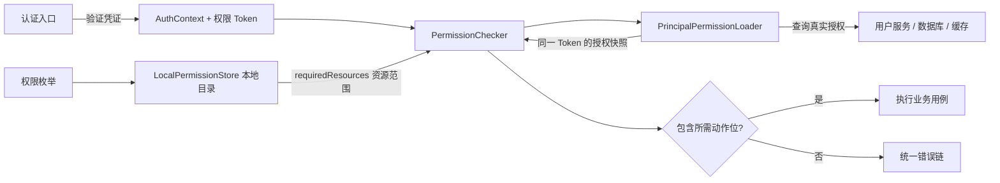

# 错误与权限：让失败可识别，让授权可落实

本章接着 [Web 业务服务](web.md)。错误模型可在纯 Java 领域层使用；权限目录和位图模型也是纯 Java，Spring starter 负责扫描、当前主体读取和方法拦截。

## 1. 定义业务错误，而不是散落异常字符串

在 `shared-kernel/src/main/java/com/example/order/sharedkernel/OrderErrors.java` 放共享错误契约，并确保模块依赖 `wuli3-core`。错误只被一个领域使用时也可以放该领域内部，不必全部塞进 shared-kernel。

```java
package com.example.order.sharedkernel;

import com.kjs.wuli3.core.error.model.ErrorCode;
import com.kjs.wuli3.core.error.model.ErrorMetadata;
import com.kjs.wuli3.core.error.model.ErrorModule;
import com.kjs.wuli3.core.error.model.ErrorOrigin;
import com.kjs.wuli3.core.error.model.ErrorSeverity;
import com.kjs.wuli3.core.error.model.ErrorVisibility;

/**
 * 表示订单用例的稳定失败语义。
 * @author 国杨 create on 2026/10/16 10:00
 */
@ErrorModule(name = "ORDER", defaultMetadata = @ErrorMetadata(origin = ErrorOrigin.CALLER))
public enum OrderErrors implements ErrorCode {
    NOT_FOUND("订单不存在"),
    CANNOT_CANCEL("当前状态不允许取消订单"),
    @ErrorMetadata(origin = ErrorOrigin.SERVER, severity = ErrorSeverity.CRITICAL,
            visibility = ErrorVisibility.INTERNAL)
    STORAGE_FAILED("订单存储失败");

    private final String message;

    OrderErrors(final String message) {
        this.message = message;
    }

    /** 返回错误的默认业务描述。 */
    @Override
    public String getMessage() {
        return this.message;
    }
}
```

当 `application.service.service-code=demo-order` 时，`NOT_FOUND` 对外公开错误码为 `DEMO-ORDER.ORDER.NOT_FOUND`。模块和常量名参与协议，发布后重命名会影响客户端判断；客户端匹配 `code`，不要依赖中文 `message`。

三个维度分别表达不同含义：

| 维度 | 选择依据 | 不应混淆的概念 |
| --- | --- | --- |
| `origin` | 谁需要修复问题：`CALLER` 或 `SERVER` | 不是谁首先抛异常 |
| `severity` | 日志与告警严重程度 | 不决定 HTTP 状态，也不等于敏感性 |
| `visibility` | 最终公开边界能暴露什么 | 不决定请求能否重试 |

可见性包括 `PUBLIC`（码和消息）、`CODE_ONLY`、`MESSAGE_ONLY`、`INTERNAL`。被隐藏的字段会替换为安全占位，不表示响应字段消失。可信内部错误传播保留诊断信息和可见性策略，最终 Web 边界才过滤；不要把 SQL、凭证、完整外部响应拼进公开错误消息。

### 业务中怎么抛

以下为应用/领域方法体片段，导入 `com.kjs.wuli3.core.assertion.Asserts`、`com.kjs.wuli3.core.error.ErrorCodeException` 以及上述 `OrderErrors`：

```java
Asserts.whenBlank(orderId).throwIllegalArgumentException("订单 ID 不能为空");
Asserts.whenFalse(cancellable).throwException(OrderErrors.CANNOT_CANCEL, "已支付订单不能直接取消");
throw new ErrorCodeException(OrderErrors.NOT_FOUND);
```

这三行展示三种独立用法，不是完整的取消流程。入口参数使用 `Asserts`，业务状态使用明确错误码；不要在公共 API 中用 `Objects.requireNonNull` 代替输入错误。构造器依赖和内部不变量仍可用 `Objects.requireNonNull` / `IllegalStateException`。

捕获外部存储异常时保留 cause：`throw new ErrorCodeException(OrderErrors.STORAGE_FAILED, cause)`。只在确实理解并转换外部错误的边界捕获，不要给每个方法包一层 `catch (Exception)`。

## 2. HTTP 上会发生什么

默认行为以当前代码为准：

| 失败 | 默认 HTTP 状态 |
| --- | --- |
| `ErrorCodeException` 且 `origin=CALLER` | 400 |
| `ErrorCodeException` 且 `origin=SERVER` | 500 |
| 请求 DTO 校验、JSON 绑定失败 | 400 |
| 路由/静态资源不存在、方法不支持、媒体类型不支持 | 404、405、415 |
| Spring Security 的认证/拒绝访问异常进入 MVC 错误链 | 401、403 |
| 未知内部异常 | 500，并做安全输出 |

特别注意：业务 `OrderErrors.NOT_FOUND` 默认是 **400**，不自动推导为 404。Wuli3 的 `PermissionErrors.UNAUTHORIZED/FORBIDDEN` 也是 `CALLER` 错误，默认同样返回 **400**，不能仅凭名称假设为 401/403。若 API 规范要求其他状态，在 bootstrap 提供 `WebErrorStatusResolver` Bean，并完整保留其他异常的状态规则；它是替换默认解析器，不是“仅覆盖一个错误”的链式扩展。不要用始终返回 400 的兜底吞掉 500、405 等语义。

`WebErrorMapper` 更适合把第三方异常转成业务错误。它是按 Spring 排序执行的处理链，首个非空结果生效；返回 `null` 表示交给后续映射。以下是配置类中的 Bean 方法片段：

```java
import com.example.order.sharedkernel.OrderErrors;
import com.kjs.wuli3.core.error.ErrorCodeException;
import com.kjs.wuli3.web.error.WebErrorMapper;
import java.util.concurrent.TimeoutException;
import org.springframework.context.annotation.Bean;

// 放入 @Configuration 类中，仅示范当前 HTTP 边界的超时分类。
@Bean
public WebErrorMapper timeoutErrorMapper() {
    return error -> error instanceof TimeoutException
            ? new ErrorCodeException(OrderErrors.STORAGE_FAILED, error)
            : null;
}
```

这个示例仅匹配直接的 `TimeoutException`，不声称所有 cause 链中的超时都被处理；真实项目应以实际客户端抛出的异常类型分类。Mapper 仅影响 Web 输出，不改变领域逻辑或 RPC 传播。告警可提供 `ErrorAlertNotifier` Bean，接收 `ErrorAlertContext` 后对接监控系统；控制超时和去重，不在异常处理线程无限等待。

## 3. 权限由四块组成



目录描述“本服务认识哪些权限”，不是“用户已获哪些权限”。权限 Token 标识可信授权主体；加载器返回这个主体的实际授权。框架不自带用户表、角色管理后台或默认全权限加载器。

在引用权限注解/Checker 的模块，例如 `adapter/build.gradle.kts`，加入：

```kotlin
dependencies {
    implementation("com.kjs.wuli3:wuli3-permission-spring-boot-starter")
}
```

若在 `bootstrap` 实现加载器，也在该模块显式声明 starter 依赖。若在 `app` 做程序式鉴权，在 `app` 声明对应依赖；`domain` 不依赖 Spring 权限拦截器。纯契约模块只需 `wuli3-permission`。

权限 starter 默认启用拦截；启动需要 `PrincipalPermissionLoader` 和 `ContextReader`。Web starter 提供后者，纯后台程序需自行装配上下文后端。缺少加载器会启动失败，不应为了消除错误而在生产关闭鉴权。

## 4. 声明资源和动作

完整文件放在 `app/src/main/java/com/example/order/app/permission/OrderPermissions.java`，在 `app` 声明 `implementation("com.kjs.wuli3:wuli3-permission")`；`adapter` 沿用生成工程对 `app` 的依赖：

```java
package com.example.order.app.permission;

import com.kjs.wuli3.permission.annotation.PermissionResource;
import com.kjs.wuli3.permission.model.ActionCode;
import com.kjs.wuli3.permission.model.PermissionCode;

/**
 * 定义订单入口使用的功能权限。
 * @author 国杨 create on 2026/10/16 10:00
 */
@PermissionResource(value = "ORDER", description = "订单")
public enum OrderPermissions implements PermissionCode {
    READ(ActionCode.READ, "查看订单"),
    CANCEL(ActionCode.ACTION_5, "取消订单"),
    VIEW_CONTACT(ActionCode.ACTION_4, "查看完整联系方式");

    private final ActionCode action;
    private final String description;

    OrderPermissions(final ActionCode action, final String description) {
        this.action = action;
        this.description = description;
    }

    /** 返回稳定的动作位。 */
    @Override
    public ActionCode getAction() {
        return this.action;
    }

    /** 返回动作业务含义。 */
    @Override
    public String getDescription() {
        return this.description;
    }
}
```

资源编码使用大写字母、数字、下划线；一个资源内动作位不可重复。`READ` 位图为 8，`ACTION_4` 为 16，`ACTION_5` 为 32；权限组合用按位或，例如只允许读取和查看联系方式为 `8 | 16 = 24`。不要使用枚举 `ordinal()` 持久化权限，也不要在升级时复用旧动作位表示新含义。

本例把权限定义放在 `app`，供应用用例和 adapter 共用；如其他服务也需要这份契约，再提取到双方可依赖的契约模块。不要让 `app` 反向依赖 `adapter`。

合并配置：

```yaml
wuli3:
  permission:
    base-packages:
      - com.example.order
    enforcement-enabled: true
```

不配置 `base-packages` 时采用 Boot 应用根包；显式列表会**替换**默认范围，因此还要加入依赖库中的权限枚举包。扫描能发现没有注册成 Bean 的枚举，启动时校验声明引用和目录冲突。`enforcement-enabled=false` 只保留目录，不创建 Checker/权限 Advisor；不是匿名用户的处理策略。

## 5. 实现加载器：返回授权，不要回显需求

`PrincipalPermissionLoader.load(token, requiredResources)` 的第二参数是服务本地声明资源及动作范围。它不是授权结果，绝不能直接 `new PrincipalPermissions(token, requiredResources)`，否则任何持有 Token 的人都会得到全部声明权限。

以下接线模板放 bootstrap。应用必须实现其中的 `PermissionDirectoryClient` Bean；该端口表示你已有的用户中心/数据库查询，不是 Wuli3 内置 API。

```java
package com.example.order.bootstrap;

import com.kjs.wuli3.permission.model.PermissionToken;
import com.kjs.wuli3.permission.model.PrincipalPermissions;
import com.kjs.wuli3.permission.spi.PrincipalPermissionLoader;
import java.util.Map;
import org.springframework.context.annotation.Bean;
import org.springframework.context.annotation.Configuration;

/**
 * 将用户中心的真实授权接入功能鉴权。
 * @author 国杨 create on 2026/10/16 10:00
 */
@Configuration(proxyBeanMethods = false)
public class PermissionConfiguration {
    /** 透传 Token 和资源需求，保留返回快照的主体绑定。 */
    @Bean
    public PrincipalPermissionLoader principalPermissionLoader(final PermissionDirectoryClient client) {
        return client::load;
    }

    /**
     * 从可信授权源读取实际授权；无授权返回同 Token 的空位图，查询失败抛异常。
     * 注意：服务端必须校验 Token 有效性；不得将 requiredResources 当作已授权结果。
     */
    @FunctionalInterface
    public interface PermissionDirectoryClient {
        PrincipalPermissions load(PermissionToken token, Map<String, Long> requiredResources);
    }
}
```

授权服务适配器应遵守：

1. 用传入的 Token 查询主体和授权版本；不能从请求参数的用户 ID 猜 Token。
2. 按 `requiredResources` 限定查询范围，返回真实授权位图。无授权资源可省略，或返回 0。
3. 返回 `new PrincipalPermissions(token, grantedMasks)`；如果远程协议返回 Token，应先验证它和请求一致，不能丢弃远程 Token 再强行贴上请求 Token。
4. 加载失败抛出异常，禁止退回其他主体的缓存、默认管理员或“最后一次成功用户”。Checker 会拒绝 `null` 和 Token 不一致的快照。

## 6. 注解与程序式鉴权

### 注解：保护 Spring 入口

将以下完整验证接口放入 `adapter.api` 包；它只验证权限链，不执行真实订单取消：

```java
package com.example.order.adapter.api;

import com.example.order.app.permission.OrderPermissions;
import com.kjs.wuli3.permission.annotation.Permission;
import java.util.Map;
import org.springframework.web.bind.annotation.GetMapping;
import org.springframework.web.bind.annotation.RequestMapping;
import org.springframework.web.bind.annotation.RestController;

/**
 * 验证读取订单的功能授权。
 * @author 国杨 create on 2026/10/16 10:00
 */
@RestController
@RequestMapping("/tutorial/permission")
public class PermissionDemoApi {
    /** 仅允许具备读取动作的主体访问。 */
    @Permission(value = "READ", resourceClass = OrderPermissions.class)
    @GetMapping
    public Map<String, String> read() {
        return Map.of("result", "allowed");
    }
}
```

等价声明是 `@Permission("ORDER:READ")`，其中 `READ` 是业务枚举常量名，不是位序号。`@PermissionResource` 只声明目录，本身不会拦截方法。

类、方法、父类/接口和重复注解的要求叠加为“全部满足”；方法注解不能取消类级要求。不要把“读或取消”写成两个重复注解，OR 使用程序式 `requireAny`。

注解依赖 Spring AOP：对象需由 Spring 管理，调用需经过代理。自调用、手动 `new`、私有方法等不会因为写了注解就被可靠拦截；将受保护用例放到独立的可代理公开方法，或在用例中显式调用 Checker。类代理下不要把受保护类/方法标为 `final`。

### 程序式：处理动态组合和展示策略

注入 `com.kjs.wuli3.permission.PermissionChecker` 后，下面可放入应用方法体；导入 `PermissionKey`、`ActionCode`、`java.util.List`：

```java
final PermissionKey read = new PermissionKey("ORDER", ActionCode.READ);
final PermissionKey cancel = new PermissionKey("ORDER", ActionCode.ACTION_5);
this.permissionChecker.require(read);
this.permissionChecker.requireAny(List.of(read, cancel));
final boolean showContact = this.permissionChecker.has(
        new PermissionKey("ORDER", ActionCode.ACTION_4));
```

三项是不同使用情境，不需要连续执行。`requireAll/requireAny` 各只加载一次快照，保证一次组合判断使用同一版本；多次独立调用 `has/require` 不保证共享快照。`has` 在缺少权限 Token 时返回 `false`，不触发加载；`require` 则抛 `UNAUTHORIZED`。Token 存在而授权不足时抛 `FORBIDDEN`。

`has` 不是吞异常的安全降级：有 Token 但加载源故障仍会抛异常。敏感字段展示可通过这个查询接入脱敏策略，见 [JSON 与输出](json.md)。功能授权通过后仍需校验数据归属和租户范围。

## 7. 缓存、变更和失效

Checker 本身不缓存。希望本地缓存时，可以继承 `AbstractPrincipalPermissionCacheLoader`，实现：

```java
import com.kjs.wuli3.permission.model.PermissionToken;
import com.kjs.wuli3.permission.model.TtlPrincipalPermissions;
import java.time.Duration;
import java.util.Map;

// 放入 AbstractPrincipalPermissionCacheLoader 的子类。
// directory 是应用自己的授权源；这里沿用上一节 PermissionDirectoryClient 契约。
@Override
protected TtlPrincipalPermissions loadPrincipalPermission(
        final PermissionToken token, final Map<String, Long> requiredResources) {
    final var granted = this.directory.load(token, requiredResources);
    if (!token.equals(granted.token())) {
        throw new IllegalStateException("授权源返回了其他主体的快照");
    }
    return new TtlPrincipalPermissions(token, granted.permissions(), Duration.ofSeconds(30));
}
```

这是替换上一节普通 Loader Bean 的另一种实现，二者不要同时注册。示例 30 秒只是业务选择，不是框架默认 TTL；应该以撤权时效和授权源有效期决定，不能让本地缓存超过 Token 的剩余有效期。

当前基类最多保留 10,000 个 Token，缓存键只包含 Token，读操作不延长 TTL；失败结果不缓存，零 TTL 不保留。没有公开的主动失效/刷新 API，也不自动订阅授权变更。它适合一个服务内稳定的资源目录，不适合多个动态资源集合复用同一个 Loader 实例。

权限变化可轮换 Token，让新请求使用新主体版本；但旧 Token 的已缓存快照仍可能在 TTL 内生效。若要求立即撤权，需在认证层拒绝旧 Token，或实现具备主动失效的业务 Loader。Redis 缓存同样需要 Token、资源范围、授权版本和失效策略，框架不会代替你定义它们。

## 8. 不连接授权服务也能验证核心判断

以下独立 `main` 用本地后端验证“有读权限、无取消权限、作用域结束清理”，不会启动 HTTP 或中间件。放在测试/演示源码，不作为生产 Loader；它的固定位图仅代表测试夹具。

```java
package com.example.order.bootstrap;

import com.example.order.app.permission.OrderPermissions;
import com.kjs.wuli3.permission.PermissionChecker;
import com.kjs.wuli3.permission.model.ActionCode;
import com.kjs.wuli3.permission.model.PermissionKey;
import com.kjs.wuli3.permission.model.PrincipalPermissions;
import com.kjs.wuli3.permission.store.LocalPermissionStore;
import com.kjs.wuli3.propagation.ContextManager;
import com.kjs.wuli3.propagation.internal.AuthContext;
import com.kjs.wuli3.propagation.internal.PrincipalType;
import com.kjs.wuli3.propagation.store.ThreadLocalContextBackend;
import java.util.List;
import java.util.Map;

/**
 * 演示可信作用域内的程序式权限判断。
 * @author 国杨 create on 2026/10/16 10:00
 */
public class PermissionSmoke {
    /** 输出读取成功、取消失败、作用域外无身份。 */
    public static void main(final String[] args) {
        final var backend = new ThreadLocalContextBackend();
        final var contexts = new ContextManager(backend, backend);
        final var checker = new PermissionChecker(new LocalPermissionStore(List.of(OrderPermissions.class)),
                (token, required) -> new PrincipalPermissions(token, Map.of("ORDER", 8L)), backend);
        final var read = new PermissionKey("ORDER", ActionCode.READ);
        final var cancel = new PermissionKey("ORDER", ActionCode.ACTION_5);
        contexts.with(new AuthContext(PrincipalType.CUSTOMER, "u-1", "演示用户", "test-v1"))
                .run(() -> {
                    System.out.println(checker.has(read));
                    System.out.println(checker.has(cancel));
                });
        System.out.println(checker.has(read));
    }
}
```

预期输出 `true`、`false`、`false`。这里显式注册第四节的权限枚举；Spring 应用则通过扫描构建目录。这个示例验证直接调用路径，不能代替 Spring 注解代理的集成测试。

HTTP 集成测试则在 `src/test` 中提供固定身份 Resolver 和测试 Loader，分别覆盖：无 Token、只有 READ、只有 CANCEL、加载器抛异常、返回其他 Token。配合 `PermissionDemoApi`，默认预期分别为 400、200、400、500、500；并断言业务方法在失败时没有执行。测试身份和固定授权不得注册到生产配置。

模块实现和完整扩展说明见[权限参考](../wuli3-permission.md)、[错误模型参考](../wuli3-core.md)。
