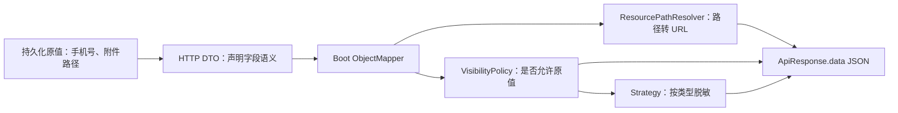

# JSON、资源地址与敏感字段

目标：数据库保存稳定的原始数据，HTTP 边界按资源域名和当前权限生成展示值。以下以订单联系人和附件为例；依赖接入见 [Web 接入](web.md)，权限装配见 [错误与权限](errors-permissions.md)。

## 1. 先选择正确的 Mapper

| 场景 | 使用入口 | 是否读取应用 Bean |
| --- | --- | --- |
| 普通 JSON、集合、消息协议读写 | `Jsons`、`JsonTrees` | 否，使用固定标准 Mapper |
| HTTP 请求与响应 | Spring Boot 管理的 `ObjectMapper`，Controller 直接返回对象 | 是，Web starter 定制 Boot Mapper |
| 独立程序、需要明确控制的协议 | `JsonMapperFactory` 创建独立 Mapper | 否，调用方显式加入装配链 |

仅引入 `wuli3-json`，在 DTO 上加注解，不会自动启用资源和脱敏模块。Web starter 通过 `Jackson2ObjectMapperBuilderCustomizer` 完成装配；自己 `new ObjectMapper()` 或调用 `Jsons` 不会继承这些 Bean。



资源转换和脱敏分别作用于不同字段，不要在同一字段同时标注 `@ResourcePath` 和 `@Desensitized`。

## 2. 普通 JSON 与泛型

依赖 `com.kjs.wuli3:wuli3-json`。以下导入加方法内片段展示基本调用：

```java
import com.fasterxml.jackson.core.type.TypeReference;
import com.kjs.wuli3.core.assertion.Asserts;
import com.kjs.wuli3.json.core.Jsons;
import java.util.List;

final String json = Jsons.toJson(List.of("order-1", "order-2"));
final List<String> ids = Jsons.fromJson(json, new TypeReference<List<String>>() {});
Asserts.whenNull(ids).throwIllegalArgumentException("订单列表不能是 JSON null");
```

泛型集合使用 `TypeReference` 保留元素类型；不要用 `List.class` 期待自动得到业务 DTO。`Jsons.fromJsonBytes` / `toJsonBytes` 用于字节载荷。

- JSON 字面量 `null` 可以解析为 Java `null`，应用自行定义是否接受。
- 解析、序列化失败转换为 `ErrorCodeException`；底层细节标记为内部可见。
- `Asserts` 表达运行时边界；静态空安全检查是否能推导非空需遵循业务工程的分析规则。
- 标准 JSON 工具不会给你做业务字段校验、文件归属校验或对象授权。

需要读取动态结构时使用树 API：

```java
import com.fasterxml.jackson.databind.JsonNode;
import com.fasterxml.jackson.databind.node.ObjectNode;
import com.kjs.wuli3.json.core.JsonTrees;

final ObjectNode payload = JsonTrees.createObjectNode();
payload.put("orderId", "order-1");
payload.put("attempt", 1);
final JsonNode parsed = JsonTrees.readTree(payload.toString());
final String orderId = parsed.path("orderId").asText();
```

`path()` 缺字段时不直接抛错。若字段必填，必须额外检查类型、存在性和内容，不能用默认空字符串掩盖协议错误。

## 3. 资源地址：默认配置的完整往返

### 3.1 添加依赖与配置

在需要 HTTP 的 adapter/bootstrap 依赖链引入 Web starter；不要为了 JSON 展示把 Web 依赖加到 domain：

```kotlin
dependencies {
    implementation("com.kjs.wuli3:wuli3-web-spring-boot-starter")
}
```

`bootstrap/src/main/resources/application.yml`：

```yaml
wuli3:
  web:
    json:
      resource:
        path:
          attachment: https://cdn.example.com/order-files
          avatar: https://cdn.example.com/avatars
```

`attachment`、`avatar` 是应用定义的资源类型，必须与注解 `type` 对应。域名是示例地址，需要替换为实际 CDN/资源服务地址。

### 3.2 定义边界 DTO

文件 `adapter/src/main/java/com/example/order/adapter/api/order/OrderContactView.java`；这是 HTTP 展示对象，不是数据库实体：

```java
package com.example.order.adapter.api.order;

import com.kjs.wuli3.json.datatype.desensitization.DesensitizationTypes;
import com.kjs.wuli3.json.datatype.desensitization.Desensitized;
import com.kjs.wuli3.json.datatype.resource.ResourcePath;

/**
 * 声明订单联系人与附件的 HTTP 展示规则。
 *
 * @author 国杨 create on 2026/10/16 16:00
 */
public record OrderContactView(
        String orderId,
        @Desensitized(type = DesensitizationTypes.PHONE) String phone,
        @ResourcePath(type = "attachment") String attachment) {}
```

Controller 方法中返回 `new OrderContactView("order-1", "13812345678", "2026/order-1.pdf")`。
正常统一响应的 `data` 应为：

```json
{
  "orderId": "order-1",
  "phone": "138****5678",
  "attachment": "https://cdn.example.com/order-files/2026/order-1.pdf"
}
```

让 Controller 返回 DTO，别先转为 JSON 字符串。这样响应包装、MVC Mapper 和字段扩展才能在同一边界工作。

### 3.3 入站转换与边界

请求字符串声明 `@ResourcePath(type = "attachment")` 后，资源反序列化器会还原配置域名下的 URL。当前版本有一项已复现限制：Boot Mapper 反序列化同时包含普通字段与资源字段的 `OrderContactView` record 时，`JacksonAnnotationLookup.find` 可能因 Jackson 参数元数据的 `getAnnotated()` 返回 null 而抛空指针。不要直接将本章响应 record 复用为入站请求；下方测试使用独立、单一资源字段的请求类型验证转换。混合字段请求需在应用集成测试中确认，或在业务边界显式调用 resolver 完成转换。以下表格描述默认 resolver 的转换规则：

| 输入或方向 | 默认结果 |
| --- | --- |
| 输出 `2026/order-1.pdf` | `https://cdn.example.com/order-files/2026/order-1.pdf` |
| 输出 `/2026/order-1.pdf` | 同上，避免重复斜杠 |
| 输入上面的完整 CDN URL | `/2026/order-1.pdf`，注意保留前导 `/` |
| 输入其他域名的 URL | 原样保留，不自动拒绝 |
| 输出绝对 URI 或 `//host/path` | 原样保留，不再拼 CDN 域名 |
| 未配置资源类型、空白值 | 原样保留；`null` 仍为 `null` |

因此“反向转换”不等于精确字节往返：`foo.pdf` 可能还原成 `/foo.pdf`。应用应统一存储路径格式，并额外校验允许的资源范围、所有权和上传权限。

对于私有附件，简单拼接 CDN 域名不具备授权能力。应用需在用例层检查访问权，再由资源服务生成短期签名地址；签名生成不是默认 resolver 的职责。

### 3.4 自定义 resolver 怎样注册

需要不同路径规则时，在 `infra.config` 或其他装配模块声明 `ResourcePathResolver` Bean。下面配置类只接受固定目录下的小写资源名，用来展示**带校验的双向转换**；不是通用 URL 规范化器。

```java
package com.example.order.infra.config;

import com.kjs.wuli3.core.assertion.Asserts;
import com.kjs.wuli3.json.datatype.resource.ResourcePathResolver;
import org.springframework.context.annotation.Bean;
import org.springframework.context.annotation.Configuration;

/**
 * 为订单附件定义受限的资源键与公开地址转换规则。
 *
 * @author 国杨 create on 2026/10/16 16:00
 */
@Configuration(proxyBeanMethods = false)
public class AttachmentJsonConfiguration {
    private static final String PREFIX = "https://cdn.example.com/order-files/";

    /** 显式接管 attachment 类型；不把任意外部 URL 转为内部路径。 */
    @Bean
    ResourcePathResolver attachmentResourcePathResolver() {
        return new ResourcePathResolver() {
            @Override
            public boolean supports(final String type) {
                return "attachment".equals(type);
            }

            @Override
            public String serialize(final String type, final String path) {
                AttachmentJsonConfiguration.validateKey(path);
                return AttachmentJsonConfiguration.PREFIX + path;
            }

            @Override
            public String deserialize(final String type, final String value) {
                Asserts.whenFalse(value.startsWith(AttachmentJsonConfiguration.PREFIX))
                        .throwIllegalArgumentException("附件地址不属于受支持的资源服务");
                final String key = value.substring(AttachmentJsonConfiguration.PREFIX.length());
                AttachmentJsonConfiguration.validateKey(key);
                return key;
            }
        };
    }

    /** 限定示例资源键格式，拒绝路径跳转与任意 URL。 */
    private static void validateKey(final String key) {
        Asserts.whenFalse(key.matches("[0-9]{4}/[a-z0-9-]+\\.pdf"))
                .throwIllegalArgumentException("附件资源键格式错误");
    }
}
```

这个替代方案要求请求提供完整的指定域名 URL，存储提供相对键；不要与默认 resolver 的“陌生值原样保留”语义混用。

**注册任意 `ResourcePathResolver` Bean 后，默认配置驱动的 `WebResourcePathResolver` 会退让。** 如果仍需要 `avatar` 等 YAML 映射，要额外声明 `new WebResourcePathResolver(properties)` Bean（参数类型 `WebJsonResourcePathProperties`），并用 Spring `@Order` 明确优先级。多个 resolver 按排序后的列表选择第一个 `supports(type)` 为真的实现；无匹配则保持原值。

避免在每个字段的序列化过程中查询数据库或调用远端签名服务；列表响应会把一次请求放大成多次 I/O。优先由应用服务批量完成必要查询，再生成专用响应 DTO。

## 4. 脱敏：默认策略、自定义类型与原值权限

### 4.1 内置策略

| 注解 `type` 常量 | 含义 |
| --- | --- |
| `DesensitizationTypes.PHONE` | 手机号 |
| `DesensitizationTypes.EMAIL` | 邮箱 |
| `DesensitizationTypes.ID_CARD` | 身份证号 |
| `DesensitizationTypes.BANK_CARD` | 银行卡号 |

Web 默认始终脱敏。短值等特殊输入有兜底掩码，具体输出需用测试固定；不能把脱敏函数当作手机号/证件格式校验器。

注解仅针对字符串属性。未知类型没有策略时序列化失败，不会悄悄输出原值。脱敏不改变对象字段，不改变数据库数据，也不保护日志、`toString()` 或直接返回的原始字符串。

### 4.2 增加一个策略

将下面 Bean 方法加入应用的 `@Configuration`，导入 `DesensitizationStrategy` 和 `Bean`：

```java
/** 将物流单号只显示末四位；不足四位时全部遮蔽。 */
@Bean
DesensitizationStrategy trackingNumberStrategy() {
    return DesensitizationStrategy.of("tracking-number", value ->
            value.length() <= 4 ? "****" : "****" + value.substring(value.length() - 4));
}
```

DTO 使用 `@Desensitized(type = "tracking-number") String trackingNumber`。
同名自定义策略覆盖内置策略；不要同时注册多个同 `type` 的 Bean 依赖偶然顺序，保持每个类型只有一个明确实现。

### 4.3 谁可以看原值

`DesensitizationVisibilityPolicy.canViewRaw(annotation)` 返回 `true` 时直接写原值。它只收到注解（当前仅含 `type`），**不知道当前字段所属用户或订单**。因此它适合“当前调用者是否拥有查看某类原值的能力”，不适合独自实现逐行数据权限。

权限接入顺序是：认证建立可信 `AuthContext` → `PermissionChecker` 读取可信权限 Token → 加载权限 → Policy 决定是否显示原值。必须先完成 [权限教程](errors-permissions.md) 的目录和加载器配置。没有业务需求时保留默认的始终脱敏即可。

示例 Bean 方法如下；`OrderPermissions.VIEW_CONTACT` 是权限教程声明的动作，按该教程导入其完整包名，并导入 `PermissionChecker`、`DesensitizationVisibilityPolicy`、`DesensitizationTypes` 和 `Bean`。枚举导入为 `com.example.order.app.permission.OrderPermissions`，此配置放在能够依赖 app 的 bootstrap 中：

```java
/** 仅对手机号开放已授权的原值查看能力，其他类型保持脱敏。 */
@Bean
DesensitizationVisibilityPolicy contactVisibilityPolicy(final PermissionChecker checker) {
    return annotation -> DesensitizationTypes.PHONE.equals(annotation.type())
            && checker.has(OrderPermissions.VIEW_CONTACT);
}
```

订单归属检查仍要在应用服务中完成。Policy 在每个敏感字段序列化时调用；`PermissionChecker.has` 每次独立加载权限，远端读取与缓存设计由加载器负责。异常不应通过 `catch` 后 `return true` 放行。

不要把使用当前权限的 MVC Mapper 用作共享缓存格式：特权调用者可能写入原值，普通调用者可能写入掩码。缓存/事件保存明确的内部模型，HTTP 输出才执行展示策略；任何携带原始个人信息的内部数据仍需按业务规则保护。

## 5. 非 Spring 程序显式组装

下面方法内片段依赖前面的 `OrderContactView`，以及 `ResourcePathResolver resolver` 参数。导入以下类型：

```java
import com.fasterxml.jackson.databind.json.JsonMapper;
import com.kjs.wuli3.json.datatype.desensitization.DesensitizationStrategyRegistry;
import com.kjs.wuli3.json.datatype.desensitization.DesensitizationVisibilityPolicy;
import com.kjs.wuli3.json.datatype.resource.ResourcePathResolver;
import com.kjs.wuli3.json.provider.JsonMapperDesensitizationAssembly;
import com.kjs.wuli3.json.provider.JsonMapperFactory;
import com.kjs.wuli3.json.provider.JsonMapperResourcePathAssembly;

final JsonMapper mapper = JsonMapperFactory.standardJsonMapperFactory()
        .addAssemblyChain(new JsonMapperResourcePathAssembly(resolver))
        .addAssemblyChain(new JsonMapperDesensitizationAssembly(
                DesensitizationStrategyRegistry.standard(),
                DesensitizationVisibilityPolicy.alwaysMask()))
        .create();
final String output = mapper.writeValueAsString(
        new OrderContactView("order-1", "13812345678", "2026/order-1.pdf"));
```

外层方法应声明或处理 `JsonProcessingException`。直接调用 Jackson Mapper 与 `Jsons` 的错误边界不同，不会自动经过 `Jsons` 的异常转换函数。

## 6. 用真实应用 Mapper 固定输出契约

将下列测试放在 `bootstrap/src/test/java/com/example/order/JsonContractTest.java`。前提：应用已配置第 3.1 节的 attachment 域名、没有安装自定义替代 resolver，并可引用 adapter 的 DTO。测试只需要 Web 应用装配，不需要 Redis/MySQL。

```java
package com.example.order;

import static org.assertj.core.api.Assertions.assertThat;

import com.example.order.adapter.api.order.OrderContactView;
import com.fasterxml.jackson.databind.JsonNode;
import com.fasterxml.jackson.databind.ObjectMapper;
import com.kjs.wuli3.json.datatype.resource.ResourcePath;
import org.junit.jupiter.api.Test;
import org.springframework.beans.factory.annotation.Autowired;
import org.springframework.boot.test.context.SpringBootTest;

/**
 * 验证应用实际使用的 JSON 资源转换与默认脱敏契约。
 *
 * @author 国杨 create on 2026/10/16 16:00
 */
@SpringBootTest(properties = {
    "wuli3.web.json.resource.path.attachment=https://cdn.example.com/order-files"
})
class JsonContractTest {
    @Autowired
    private ObjectMapper mapper;

    /** 独立验证资源入站转换，不复用混合字段的响应 record。 */
    record AttachmentInput(@ResourcePath(type = "attachment") String attachment) {}

    /** 输出脱敏值和资源 URL，反向解析保留默认路径语义。 */
    @Test
    void serializesPresentationWithoutChangingOriginal() throws Exception {
        final OrderContactView view =
                new OrderContactView("order-1", "13812345678", "2026/order-1.pdf");
        final JsonNode json = this.mapper.readTree(this.mapper.writeValueAsString(view));
        assertThat(json.path("phone").asText()).isEqualTo("138****5678");
        assertThat(json.path("attachment").asText())
                .isEqualTo("https://cdn.example.com/order-files/2026/order-1.pdf");
        assertThat(view.phone()).isEqualTo("13812345678");
        final AttachmentInput restored = this.mapper.readValue(
                """
                {"attachment":"https://cdn.example.com/order-files/2026/order-1.pdf"}
                """, AttachmentInput.class);
        assertThat(restored.attachment()).isEqualTo("/2026/order-1.pdf");
    }
}
```

执行 `./gradlew :bootstrap:test --tests '*JsonContractTest'`。引入原值权限 Policy 后，还应分别建立有权限和无权限的上下文测试；引入自定义 resolver 后，按它的存储键和拒绝规则修改断言。反序列化不会把已被掩码替换的手机号恢复成原手机号，编辑接口应避免把展示用掩码重新保存为真实业务值。

详细契约见 [JSON 模块](../wuli3-json.md)，实现入口见 [WebJsonAutoConfiguration](../../wuli3-web-spring-boot-starter/src/main/java/com/kjs/wuli3/web/autoconfigure/WebJsonAutoConfiguration.java)。
