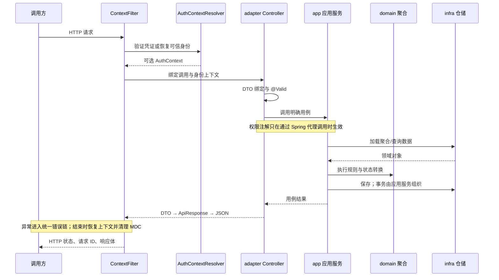

# Web 业务服务：从入口到完整用例

先完成[创建项目](project.md)，再扩展真实业务。Web starter 提供的是 HTTP 基础设施；生成工程提供的是能运行的 CRUD 骨架。登录、业务规则、数据归属和持久化仍需要业务服务实现。

## 1. 框架和业务各自负责什么

| 环节 | Wuli3 已提供 | 业务服务必须补齐 |
| --- | --- | --- |
| 请求上下文 | 请求 ID、客户端 IP、身份上下文作用域、请求结束清理 | 认证来源、代理信任范围、异步执行器接入 |
| 请求绑定 | Spring MVC、Jackson、Bean Validation | 请求 DTO、字段约束、跨字段与业务状态校验 |
| 认证与授权 | `AuthContextResolver`、独立权限 starter | 验证凭证、加载授权、数据归属校验；引入 Web 不会自动保护所有接口 |
| 用例执行 | 生成分层骨架和架构门禁 | 聚合行为、事务、幂等、并发更新、外部服务失败策略 |
| 存储 | 可选 starter、仓储示例 | 表/索引、查询、迁移、连接配置和事务能力 |
| 输出 | 成功包装、异常映射、JSON 扩展 | 返回 DTO、错误码、资源域名、脱敏规则 |
| 运维 | 可组合的配置与错误通知扩展点 | 可观测性接入、告警实现、管理端口访问控制 |

生成器的 `save` 示例适合验证工程，不是所有业务都应公开的“任意改状态”接口。真实订单应提供提交、支付、取消等明确用例，在聚合中限制状态转换。



## 2. 依赖与配置放在哪里

生成工程已经声明的依赖不要重复添加。已有工程在使用 Web 类型的模块添加：

```kotlin
dependencies {
    implementation("com.kjs.wuli3:wuli3-web-spring-boot-starter")
}
```

上面依赖省略版本的前提是已经导入 BOM，见[项目接入](project.md)。生成工程通常在 `adapter` 写 Controller，在 `bootstrap` 写最终配置，在 `app` 写事务和用例；不要为了取得 Web 类型让 `domain` 依赖 starter。

合并到 `bootstrap/src/main/resources/application.yml`：

```yaml
application:
  service:
    service-code: demo-order
wuli3:
  web:
    context:
      enabled: true
      accept-external-request-id: true
      request-id-max-length: 128
      trusted-proxy-cidrs: []
    response:
      wrapper-enabled: true
      exception-handler-enabled: true
      wrap-response-entity-body: true
      validation-detail-enabled: true
      success-message: ""
```

空代理列表意味着不使用转发头确定客户端 IP；部署在代理后面时填实际可信代理网段。**这个列表只控制 IP 解析，不会限制身份头来源。** 默认 `AuthContextResolver` 从内部身份头恢复身份，前提是上游已完成认证且入口不可被外部绕过；直接面向公网的服务必须替换它。

`context.enabled=false` 只关闭请求上下文过滤器注册，不是关闭所有上下文 Bean、HTTP 客户端定制器或认证系统的总开关。

## 3. 先写一个可运行的边界示例

以下完整类放在 `adapter/src/main/java/com/example/order/adapter/api/BoundaryDemoApi.java`。它只用于验证参数、包装和错误链，不写数据库；理解边界后删除 `/tutorial` 示例接口。

```java
package com.example.order.adapter.api;

import com.kjs.wuli3.core.assertion.Asserts;
import com.kjs.wuli3.web.response.NativeResponse;
import jakarta.validation.Valid;
import jakarta.validation.constraints.NotBlank;
import jakarta.validation.constraints.Positive;
import org.springframework.web.bind.annotation.GetMapping;
import org.springframework.web.bind.annotation.PostMapping;
import org.springframework.web.bind.annotation.RequestBody;
import org.springframework.web.bind.annotation.RequestMapping;
import org.springframework.web.bind.annotation.RestController;

/**
 * 演示 HTTP 输入校验与响应边界。
 * @author 国杨 create on 2026/10/16 10:00
 */
@RestController
@RequestMapping("/tutorial/boundary")
public class BoundaryDemoApi {
    /** 校验字段后执行一个业务约束，返回普通 DTO。 */
    @PostMapping
    public Preview preview(@Valid @RequestBody final PreviewRequest request) {
        Asserts.whenTrue(request.quantity() > 100)
                .throwIllegalArgumentException("单次预览数量不能超过 100");
        return new Preview(request.productId(), request.quantity());
    }

    /** 返回第三方协议需要的原始文本。 */
    @NativeResponse
    @GetMapping(value = "/ping", produces = "text/plain")
    public String ping() {
        return "pong";
    }

    /** 仅表示 HTTP 输入形状，不承担领域状态转换。 */
    public record PreviewRequest(@NotBlank String productId, @Positive int quantity) {}

    /** 表示本次预览结果。 */
    public record Preview(String productId, int quantity) {}
}
```

启动后验证：

```bash
curl -i -X POST http://localhost:8080/tutorial/boundary \
  -H 'Content-Type: application/json' \
  -d '{"productId":"p-1","quantity":2}'
curl -i -X POST http://localhost:8080/tutorial/boundary \
  -H 'Content-Type: application/json' \
  -d '{"productId":"","quantity":0}'
curl -i -X POST http://localhost:8080/tutorial/boundary \
  -H 'Content-Type: application/json' \
  -d '{"productId":"p-1","quantity":101}'
curl -i http://localhost:8080/tutorial/boundary/ping
```

预期依次为：HTTP 200 且 `code="0"`、HTTP 400 字段校验失败、HTTP 400 统一非法参数错误、原始文本 `pong`。第一项 `data` 为 `{"productId":"p-1","quantity":2}`；框架补充 `timestamp`、`requestId` 等字段。真实用例中，将业务检查移动到应用/领域层，保证 HTTP、消息和 RPC 入口共用同一规则。

### 返回值怎么选

- 普通 DTO、集合、`null` 默认包装；不要先用 JSON 工具序列化 DTO 再返回字符串，否则容易把对象变成 JSON 字符串字段。
- 已有 `ApiResponse<?>` 不重复包装。一般不需要 Controller 手动构造它。
- `ResponseEntity<T>` 保留 HTTP 状态，默认包装 body；可用 `wrap-response-entity-body=false` 调整。
- `byte[]`、Spring `Resource`、流式响应及 `ProblemDetail` 原样输出；HTTP 204/304 不写响应体。
- `@NativeResponse` 默认只跳过成功包装，异常仍是统一错误体。`@NativeResponse(NativeResponseMode.ALL)` 的异常采用 `ProblemDetail`，不表示“完全不处理异常”。

## 4. 接入真实认证

`AuthContext` 保存认证结果，不验证密码、JWT 签名或会话状态。`principalPermissionToken` 是授权主体码，不必等于用户 ID，更不是直接把来路不明的 Bearer 文本塞进去。

下面是**认证接线模板**，放 `bootstrap` 扫描范围内；需要应用提供 `AccessTokenVerifier` Bean，模板本身不会伪造一个登录实现。若该模块未直接声明 Web starter 依赖，补上第二节依赖。

```java
package com.example.order.bootstrap;

import com.kjs.wuli3.core.assertion.Asserts;
import com.kjs.wuli3.propagation.internal.AuthContext;
import com.kjs.wuli3.web.auth.AuthContextResolver;
import java.util.Optional;
import org.springframework.context.annotation.Bean;
import org.springframework.context.annotation.Configuration;

/**
 * 将业务凭证验证结果接入请求上下文。
 * @author 国杨 create on 2026/10/16 10:00
 */
@Configuration(proxyBeanMethods = false)
public class HttpIdentityConfiguration {
    /** 无凭证允许进入匿名流程；无效凭证由验证器拒绝。 */
    @Bean
    public AuthContextResolver authContextResolver(final AccessTokenVerifier verifier) {
        return request -> {
            final String authorization = request.getHeader("Authorization");
            if (authorization == null) {
                return Optional.empty();
            }
            Asserts.whenFalse(authorization.startsWith("Bearer "))
                    .throwIllegalArgumentException("Authorization 格式错误");
            final String credential = authorization.substring(7);
            Asserts.whenBlank(credential).throwIllegalArgumentException("访问凭证不能为空");
            return Optional.of(verifier.verify(credential));
        };
    }

    /** 对接认证服务或本地验签；验证失败应抛出明确的认证错误。 */
    @FunctionalInterface
    public interface AccessTokenVerifier {
        AuthContext verify(String credential);
    }
}
```

验证器需完成凭证真实性、有效期、吊销状态以及所选协议要求的校验，再返回例如 `new AuthContext(PrincipalType.CUSTOMER, userId, displayName, permissionToken)`。`PrincipalType` 的包为 `com.kjs.wuli3.propagation.internal`；当前提供 `CUSTOMER`、`ADMIN`、`SYSTEM`。

无凭证返回空身份不等于禁止请求：公开接口仍可执行，受保护用例通过[权限机制](errors-permissions.md)拒绝缺少权限 Token 的请求。只有三参数的 `AuthContext` 可以表示已认证用户，但不提供权限鉴权凭据。

如果验证器依赖 Spring Security 先前建立的身份，必须核对过滤器顺序：Wuli3 默认很早执行，并不会自动等待 Security 的认证过滤器。调整 `wuli3.web.context.filter-order` 或在 Resolver 内完成认证，不要在身份尚未建立时读取它。

## 5. 把骨架补成业务用例

以“取消订单”为例，按以下职责实现，不把所有逻辑堆在 Controller：

1. `adapter` 定义 `CancelOrderRequest`，校验原因长度；读取路径订单 ID，并调用应用服务。
2. `app` 的公开用例方法加载订单，完成当前主体访问这笔订单的检查，调用聚合的 `cancel(reason)`，保存结果；数据库事务放在这个用例边界。
3. `domain` 根据订单当前状态决定能否取消，失败抛业务错误码；不读取 Servlet、Redis 或用户服务。
4. `infra` 实现仓储、乐观锁/版本检查、数据转换；应用服务依赖接口。
5. 需要通知其他模块时，选择合适的[事件与上下文机制](context-events.md)。事务提交后监听不等于可靠投递，跨服务一致性需设计 Outbox/重试等方案。

功能权限“可以取消订单”并不能证明“可以取消这一笔订单”；订单归属、租户范围和业务状态仍由用例检查。幂等键、重复取消行为、并发付款冲突也必须明确，生成工程不会替你决定。

## 6. 验证与扩展顺序

先执行 `./gradlew :adapter:compileJava :bootstrap:bootJar`，再运行上述请求。业务增加后补充应用服务测试和 MVC 测试，覆盖合法输入、字段失败、业务失败、无身份、无权限、跨主体访问和重复请求；最后执行 `./gradlew check`。

响应错误扩展和权限加载见[错误与权限](errors-permissions.md)；JSON、资源地址与脱敏见[JSON 与输出](json.md)。完整配置项与其他 Web 扩展点见 [Web 模块参考](../wuli3-web-spring-boot-starter.md)。
