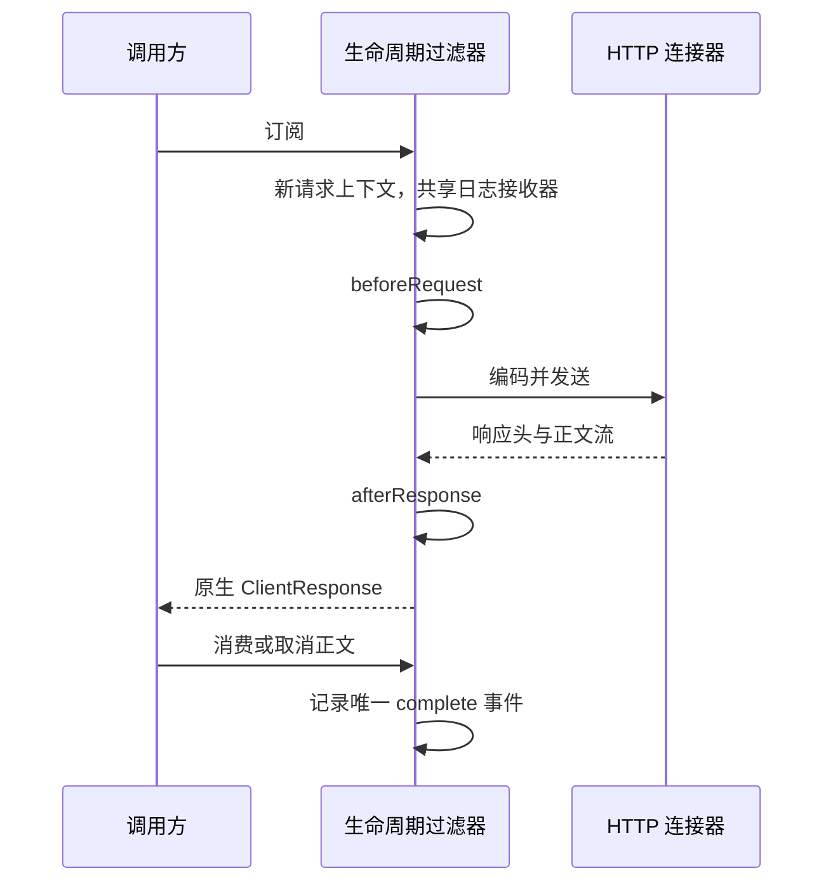

# wuli3-http

单个普通 Java 模块，显式构建并返回 Spring 原生 `WebClient`。不启动 Spring 容器，不提供自动配置。默认使用 Reactor Netty，传输替换使用原生 `ClientHttpConnector`，请求 API、状态处理及 DTO 解码仍由 WebClient 提供。

## 接入与使用

导入 Wuli3 BOM 后添加依赖：

```kotlin
implementation("com.kjs.wuli3:wuli3-http")
```

```java
final WebClientConfig config = new WebClientConfig(
        "partner",
        "https://partner.example.org",
        new HttpHeaders(),
        Duration.ofSeconds(3),
        Duration.ofSeconds(30),
        256 * 1024,
        HttpLogOptions.defaults());

final WebClient client = WebClientFactory.builder(config)
        .initialize(context -> context.builder().defaultHeader("X-App", "orders"))
        .beforeRequest((context, request) -> Mono.just(
                ClientRequest.from(request).header("X-Request-Id", context.id()).build()))
        .afterResponse((context, response) -> Mono.just(response))
        .onError((context, error) -> context.logRecorder().record(
                HttpLogEvent.DIAGNOSTIC, Map.of("exchangeId", context.id(), "type", error.getClass().getName())))
        .build();

final Mono<String> result = client.get()
        .uri("/orders/{id}", "123")
        .retrieve()
        .bodyToMono(String.class);
```

模块公共类型分别来自 `com.kjs.wuli3.http.webclient` 和 `com.kjs.wuli3.http.logging`，其余类型来自 `org.springframework.http`、`org.springframework.web.reactive.function.client`、`java.time` 与 `reactor.core.publisher`。只使用绝对 URL 时可用 `WebClientConfig.defaults("partner")`，无需填写 baseUrl。

包职责：

| 包 | 职责 |
| --- | --- |
| `com.kjs.wuli3.http.webclient` | 客户端工厂、配置、初始化与请求上下文；交换实现仅包内可见 |
| `com.kjs.wuli3.http.logging` | 日志选项与接收器扩展契约 |
| `com.kjs.wuli3.http.internal.logging` | 日志地址脱敏及接收器故障隔离；供模块内部使用 |

客户端构建完成后可并发复用。模块不会内部调用 `block()` 或 `subscribe()`；何时订阅、如何组合与取消由调用方决定。

## 回调契约

| 注册方法 | 类型 | 执行时机 |
| --- | --- | --- |
| `initialize` | `Consumer<InitializationContext>` | 应用默认配置后，每次 build 一次；通过 `context.builder()` 定制原生能力 |
| `beforeRequest` | `BiFunction<HttpExchangeContext, ClientRequest, Mono<ClientRequest>>` | 每次订阅、网络交换前 |
| `afterResponse` | `BiFunction<HttpExchangeContext, ClientResponse, Mono<ClientResponse>>` | 收到响应头后、向下游交付响应前 |
| `onError` | `BiConsumer<HttpExchangeContext, Throwable>` | 请求转换、交换、响应转换或正文传输失败 |
| `onInitializationError` | `BiConsumer<InitializationContext, Throwable>` | 初始化或构建失败 |

同类回调可以注册多个，按注册顺序执行。签名、验签、解密是这些函数的使用场景，不是内置处理器类型。异步转换应返回一个元素；同步抛错、返回 null、空 Mono、异步错误都会终止正常链路。



每次订阅都有独立的 `id()` 与 `attributes()`，包括对同一个 Mono 的重复订阅。同一次调用的回调共享上下文，全部请求共用客户端的 `logRecorder()`。回调可能切换线程，避免线程局部变量及阻塞操作；共享业务状态自行保证并发安全。

`afterResponse` 表示拿到 HTTP 响应，不表示正文已读取。正文完成、错误或取消后，模块记录唯一终结日志。错误观察器只调用一次，其异常会被附加到原异常的 suppressed 列表。构建错误同样保留原异常。

这里的完成与失败以 **HTTP 交换** 为边界。`retrieve()` 将 4xx/5xx 转换为异常，以及下游 DTO 解码失败，不会被重复转换为模块错误。解码器提前终止正文读取时，终结摘要记录为取消；原生 WebClient 也可能包装传输异常并保留原始 cause。业务成功判定、重试及整体截止时间由调用方在原生链路处理。

使用 `exchangeToMono` / `exchangeToFlux` 时，原生 WebClient 会清理未消费正文。直接使用底层 `exchange()` 的调用方须消费或释放响应正文，否则既不能完成资源生命周期，也无法形成正文终结记录。

## 正文转换

请求转换可以用 `ClientRequest.from(request)` 修改头、URI 或 BodyInserter。签名依赖最终编码字节时，应在业务协议适配处显式生成字节，签名和发送使用同一份字节。

响应转换可以保持流式，也可以按业务协议有界聚合。以下片段用于 `afterResponse`，`decrypt` 是调用方提供的 `UnaryOperator<String>`：

```java
(context, response) -> DataBufferUtils.join(
                response.bodyToFlux(DataBuffer.class), 256 * 1024)
        .map(buffer -> {
            try {
                final String plaintext = decrypt.apply(buffer.toString(StandardCharsets.UTF_8));
                return response.mutate()
                        .headers(headers -> {
                            headers.remove(HttpHeaders.CONTENT_LENGTH);
                            headers.remove(HttpHeaders.CONTENT_ENCODING);
                        })
                        .body(ignored -> Flux.just(plaintext).map(value ->
                                DefaultDataBufferFactory.sharedInstance.wrap(value.getBytes(StandardCharsets.UTF_8))))
                        .build();
            } finally {
                DataBufferUtils.release(buffer);
            }
        })
```

消费、替换正文的回调负责释放旧缓冲区、设置正确的内容类型及相关长度/编码头，并处理空正文。示例使用 `body(Function)`，避免原生 `body(String)` / `body(Flux)` 替换重载自动订阅旧正文进行释放。模块在响应回调失败或取消时取消尚未消费的当前正文并清理丢弃缓冲区；不会再次订阅已经开始消费的旧正文。回调自己订阅正文、遗弃旧响应或遗弃自行创建的资源，超出模块能够管理的边界。

## 日志

默认通过 SLF4J 2 key-value 输出，现有 `%kvp` 格式可直接显示。模块只记录方法、脱敏地址、响应状态、耗时和错误类型，正文与请求／响应头由业务回调按需记录。

```java
WebClientFactory.builder(config)
        .logRecorder((event, fields) -> store.accept(event, fields))
        .build();
```

`store` 为调用方提供的线程安全、快速、非阻塞接收函数。接收器在构建时固定，初始化与全部并发请求共用同一个接收器，通过 `exchangeId` 关联请求。接收器抛出的运行时异常不会改变 HTTP 结果。

事件参数为 `HttpLogEvent`：初始化事件 `INITIALIZED` / `INITIALIZATION_ERROR`；请求事件 `REQUEST`、`RESPONSE`、`COMPLETE`；回调补充诊断使用 `DIAGNOSTIC`。默认 SLF4J 输出使用小写事件名。

- `REQUEST`：完成前置处理后的方法与脱敏地址。
- `RESPONSE`：响应转换前的原始 HTTP 状态。
- `COMPLETE`：正文完成、错误或取消时的结果、耗时和错误类型；前置处理或连接失败也会终结。

耗时从订阅开始，包含回调与正文消费。HTTP 业务失败结合 `RESPONSE` 的状态判断。业务诊断可通过 `context.logRecorder()` 写入，并显式带上 `context.id()`；诊断字段由调用方自行脱敏。

| 选项 | 默认值 |
| --- | --- |
| `enabled` | true，启用摘要 |
| `redact` | true，脱敏查询参数 |
| `sensitiveNames` | 认证、Cookie、密码、密钥、令牌及签名等常用名称 |

补充业务敏感名称：

```java
final HttpLogOptions logging = new HttpLogOptions(true, true, Set.of("account-number"));
```

`sensitiveNames` 只补充内置名单，忽略名称大小写以及下划线、连字符等差异；包含 password、secret、token 的名称也会隐藏。传入 null 或空集合保留内置名单，访问器返回合并后的非空、不可变集合。集合元素为 null 或空白时进入统一错误码异常链。URI 用户凭据和片段始终省略。

`enabled=false` 时跳过摘要加工和接收器调用，生命周期回调仍正常执行。业务需要记录协议正文时，在签名、解密等回调中使用已有的业务数据显式记录。

## 传输、超时与资源

默认 Reactor Netty 使用共享连接池与事件循环，不为每个客户端创建专属线程。关闭默认网络重试及重定向；调用方可以在原生响应链上显式设置重试策略，并承担重放正文、幂等性及多次订阅的语义。

配置默认连接超时 3 秒，响应读取间隔超时 30 秒。后者不是整个调用的截止时间；初始化、回调和 DTO 解码也不受这个读取超时控制。整体截止时间可以在最终 Mono/Flux 上使用 `timeout(...)`。

替换连接器示例：

```java
final WebClient client = WebClientFactory.builder(config)
        .connector(new JdkClientHttpConnector())
        .build();
```

自定义连接器的超时、连接池、重试、重定向和关闭生命周期由调用方管理，配置中的 Reactor Netty 超时不再应用。当前只提供 WebClient 适配，不引入独立请求 DSL 或其他客户端实现。

通过 `initialize(context -> context.builder()...)` 配置 codecs、原生过滤器、TLS 等能力；原生高级覆盖遵循 WebClient 的优先级。例如自定义 `exchangeFunction` 会替代连接器与默认编解码交换函数，`mutate().filters(...)` 也可以移除模块过滤器，因此调用方自行承担这些覆盖的行为。

## 验证

```bash
./gradlew :wuli3-http:check
```

测试使用真实本地 HTTP 服务及池化缓冲区，覆盖无容器调用、初始化次数、回调顺序、重复订阅与并发隔离、各阶段错误及取消、异常保留、正文转换与释放、共享接收器、日志开关与查询参数脱敏，以及 JDK 连接器替换。
