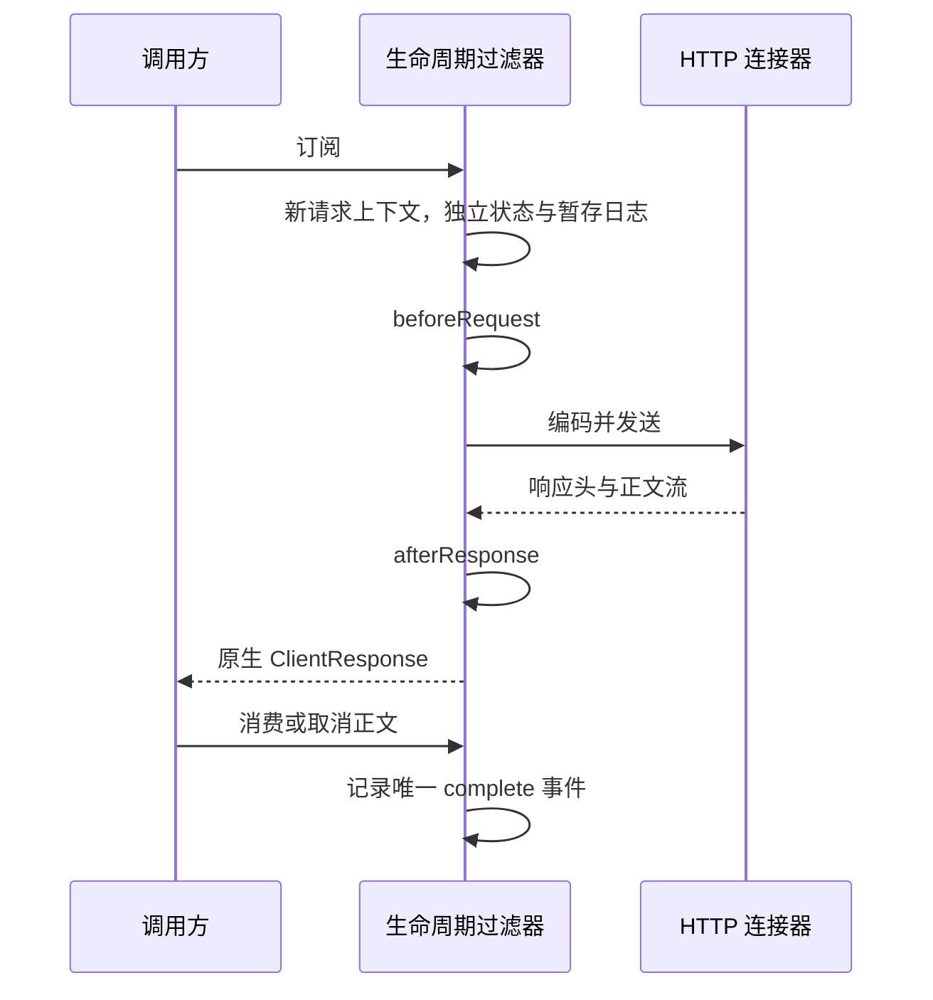

# wuli3-http

单个普通 Java 模块，显式构建并返回 Spring 原生 `WebClient`。不启动 Spring 容器，不提供自动配置。默认使用 Reactor Netty，传输替换使用原生 `ClientHttpConnector`，请求 API、状态处理及 DTO 解码仍由 WebClient 提供。

## 接入与使用

导入 Wuli3 BOM 后添加依赖：

```kotlin
implementation("com.wulicode.wuli3:wuli3-http")
```

```java
final WebClientConfig config = new WebClientConfig(
        "partner",
        "https://partner.example.org",
        new HttpHeaders(),
        Duration.ofSeconds(3),
        Duration.ofSeconds(30),
        256 * 1024,
        HttpLogOptions.defaults());

final WebClient client = WebClientFactory.builder(config)
        .initialize(context -> context.builder().defaultHeader("X-App", "orders"))
        .beforeRequest((context, request) -> Mono.just(
                ClientRequest.from(request).header("X-Request-Id", context.id()).build()))
        .afterResponse((context, response) -> Mono.just(response))
        .onError((context, error) -> context.addLog(Map.of("step", "error", "type", error.getClass().getName())))
        .build();

final Mono<String> result = client.get()
        .uri("/orders/{id}", "123")
        .retrieve()
        .bodyToMono(String.class);
```

模块公共类型来自 `com.wulicode.wuli3.http.webclient`、`com.wulicode.wuli3.http.webclient.callback` 和 `com.wulicode.wuli3.http.logging`，其余类型来自 `org.springframework.http`、`org.springframework.web.reactive.function.client`、`java.time` 与 `reactor.core.publisher`。只使用绝对 URL 时可用 `WebClientConfig.defaults("partner")`，无需填写 baseUrl。

包职责：

| 包 | 职责 |
| --- | --- |
| `com.wulicode.wuli3.http.webclient` | 客户端工厂、配置、初始化与请求上下文；交换实现仅包内可见 |
| `com.wulicode.wuli3.http.webclient.callback` | 请求转换、响应转换和错误观察的函数式回调接口 |
| `com.wulicode.wuli3.http.logging` | 日志选项与接收器扩展契约 |
| `com.wulicode.wuli3.http.internal.logging` | 有界正文采集、脱敏及接收器故障隔离；供模块内部使用 |

客户端构建完成后可并发复用。模块不会内部调用 `block()` 或 `subscribe()`；何时订阅、如何组合与取消由调用方决定。

## 回调契约

| 注册方法 | 类型 | 执行时机 |
| --- | --- | --- |
| `initialize` | `Consumer<InitializationContext>` | 应用默认配置后，每次 build 一次；通过 `context.builder()` 定制原生能力 |
| `beforeRequest` | `HttpRequestProcessor` | 每次订阅、网络交换前 |
| `afterResponse` | `HttpResponseProcessor` | 收到响应头后、向下游交付响应前 |
| `onError` | `HttpErrorHandler` | 请求转换、交换、响应转换或正文传输失败 |
| `onInitializationError` | `BiConsumer<InitializationContext, Throwable>` | 初始化或构建失败 |

请求和响应处理器通过 `process(context, request/response)` 返回转换结果，错误处理器通过 `handle(context, error)` 观察错误。三个接口均为 `@FunctionalInterface`，支持 Lambda 和方法引用，位于 `com.wulicode.wuli3.http.webclient.callback` 包中。

同类回调可以注册多个，按注册顺序执行；回调实例可被并发请求复用，实现须保证线程安全。签名、验签、解密是这些函数的使用场景，不是内置处理器类型。异步转换应返回一个元素；同步抛错、返回 null、空 Mono、异步错误都会终止正常链路。



每个客户端只创建一个 `HttpExchange`，构建时冻结回调列表。每次订阅在 `Mono.defer` 内创建独立的 `HttpExchangeContext`，包括重复订阅与重试；标识、计时、终结状态、正文采集及诊断条目均在本次上下文中。同一次调用的回调共享上下文，通过 `id()` 关联请求、通过 `attributes()` 共享业务临时数据。回调可能切换线程，避免线程局部变量及阻塞操作；共享业务状态自行保证并发安全。

`afterResponse` 表示拿到 HTTP 响应，不表示正文已读取。正文完成、错误或取消后，模块记录唯一终结日志。错误观察器只调用一次，其异常会被附加到原异常的 suppressed 列表。构建错误同样保留原异常。

这里的完成与失败以 **HTTP 交换** 为边界。`retrieve()` 将 4xx/5xx 转换为异常，以及下游 DTO 解码失败，不会被重复转换为模块错误。解码器提前终止正文读取时，终结摘要记录为取消；原生 WebClient 也可能包装传输异常并保留原始 cause。业务成功判定、重试及整体截止时间由调用方在原生链路处理。

使用 `exchangeToMono` / `exchangeToFlux` 时，原生 WebClient 会清理未消费正文。直接使用底层 `exchange()` 的调用方须消费或释放响应正文，否则既不能完成资源生命周期，也无法形成正文终结记录。

## 正文转换

请求转换可以用 `ClientRequest.from(request)` 修改头、URI 或 BodyInserter。签名依赖最终编码字节时，应在业务协议适配处显式生成字节，签名和发送使用同一份字节。

响应转换可以保持流式，也可以按业务协议有界聚合。以下片段用于 `afterResponse`，`decrypt` 是调用方提供的 `UnaryOperator<String>`：

```java
(context, response) -> DataBufferUtils.join(
                response.bodyToFlux(DataBuffer.class), 256 * 1024)
        .map(buffer -> {
            try {
                final String plaintext = decrypt.apply(buffer.toString(StandardCharsets.UTF_8));
                return response.mutate()
                        .headers(headers -> {
                            headers.remove(HttpHeaders.CONTENT_LENGTH);
                            headers.remove(HttpHeaders.CONTENT_ENCODING);
                        })
                        .body(ignored -> Flux.just(plaintext).map(value ->
                                DefaultDataBufferFactory.sharedInstance.wrap(value.getBytes(StandardCharsets.UTF_8))))
                        .build();
            } finally {
                DataBufferUtils.release(buffer);
            }
        })
```

消费、替换正文的回调负责释放旧缓冲区、设置正确的内容类型及相关长度/编码头，并处理空正文。示例使用 `body(Function)`，避免原生 `body(String)` / `body(Flux)` 替换重载自动订阅旧正文进行释放。模块在响应回调失败或取消时取消尚未消费的当前正文并清理丢弃缓冲区；不会再次订阅已经开始消费的旧正文。回调自己订阅正文、遗弃旧响应或遗弃自行创建的资源，超出模块能够管理的边界。

## 日志

默认通过 SLF4J 2 key-value 输出，现有 `%kvp` 格式可直接显示。一次请求只在结束时输出一条 `COMPLETE`，请求和响应信息汇总到同一条日志；初始化成功或失败仍单独记录。

固定摘要字段为 `client`、`exchangeId`、`method`、`url`、`status`、`outcome`、`elapsedNanos`，失败时增加 `error`（异常类型）；未取得的字段省略。请求信息以 `beforeRequest` 处理后为准；请求头在提交前更新编码器补充的头部。响应状态、头部及正文以全部 `afterResponse` 处理后为准，响应处理失败时保留最后已知的状态和头部。

`outcome` 为 `complete`、`error` 或 `cancelled`，耗时单位为纳秒，从订阅开始，包含回调与正文消费。HTTP 业务成功与否结合 `status` 判断；`complete` 不代表业务成功。

通过枚举选择详情，以下示例启用请求头、响应头和两侧正文，每侧最多采集 8 KiB：

```java
final HttpLogOptions logging = new HttpLogOptions(
        true,
        true,
        Set.of("account-number"),
        Set.of(HttpLogItem.REQUEST_HEADERS, HttpLogItem.RESPONSE_HEADERS,
                HttpLogItem.REQUEST_BODY, HttpLogItem.RESPONSE_BODY),
        8 * 1024);
```

开启后新增 `requestHeaders`、`responseHeaders`、`requestBody`、`responseBody` 中被选中的字段，正文项还包含 `requestBodyState`／`responseBodyState`：

| 正文状态 | 含义 |
| --- | --- |
| `complete` | 正文完整且可安全输出，包含对应正文；空正文为 `""` |
| `unavailable` | 尚未进入该侧正文阶段 |
| `incomplete` | 错误或取消时正文尚未完整结束 |
| `too_large` | 超过该侧采集上限 |
| `unsupported` | 不支持采集或无法自动脱敏的内容类型、编码或零拷贝文件 |
| `invalid` | 字符解码、正文解析或采集失败 |

除 `complete` 外均省略正文，不打印原始片段。采集随正常发送／消费旁路复制有限字节，不额外订阅、不聚合整个正文、不改变 DataBuffer 读位置或释放责任。保留原生 Mono 写入、分组刷新和零拷贝传输；文件不会因日志而额外读取。正文内容仍按原样发送、交付给调用者。

开启脱敏时，自动处理 JSON（含 `+json`）嵌套字段和表单敏感参数；普通文本无法按字段安全脱敏，默认跳过。显式设置 `redact=false` 后可记录普通文本。二进制、multipart、SSE 和仍带非 identity 内容编码的正文跳过。JSON 必须完整可解析，不完整、超限或解析失败时不会回退输出原文。

业务回调通过 `context.addLog(...)` 追加诊断条目，随同一条日志的 `diagnostics` 列表按追加顺序输出：

```java
.beforeRequest((context, request) -> {
    context.addLog(Map.of("step", "sign", "result", "ok"));
    return Mono.just(request);
})
.afterResponse((context, response) -> {
    context.addLog(Map.of("step", "decrypt", "result", "ok"));
    return Mono.just(response);
})
```

`addLog` 支持并发追加，复制 Map 本身并拒绝空字段名和 null 键值；值应为不可变对象，并由业务调用方自行脱敏。终结快照生成后忽略追加；错误回调在快照前执行，因此其诊断条目也会进入最终日志。请求上下文不再暴露直接输出的 `logRecorder()`。

示意输出（省略时间与线程，字段顺序由日志实现决定）：

```text
INFO http.event=complete client=partner exchangeId=... method=POST url=https://api.example.com/orders status=200 outcome=complete elapsedNanos=125000000 requestBody={"password":"***","quantity":2} requestBodyState=complete responseBody={"orderId":"O001"} responseBodyState=complete diagnostics=[{step=sign, result=ok}] HTTP client
```

替换最终日志接收器：

```java
WebClientFactory.builder(config)
        .logRecorder((event, fields) -> store.accept(event, fields))
        .build();
```

`store` 为调用方提供的线程安全、快速、非阻塞接收函数。接收器在构建时固定，初始化与全部并发请求共用同一个接收器，通过 `exchangeId` 关联请求。接收器抛出的运行时异常不会改变 HTTP 结果。

事件参数为 `HttpLogEvent`，只包含 `INITIALIZED`、`INITIALIZATION_ERROR`、`COMPLETE`；默认 SLF4J 输出使用小写事件名。移除了分阶段的 `REQUEST`／`RESPONSE` 和即时诊断的 `DIAGNOSTIC`，原诊断调用改用 `context.addLog(...)`。

| 选项 | 默认值 |
| --- | --- |
| `enabled` | true，启用汇总日志 |
| `redact` | true，脱敏查询参数、头部及支持的正文 |
| `sensitiveNames` | 认证、Cookie、密码、密钥、令牌及签名等常用名称 |
| `items` | 空集合，仅固定摘要 |
| `maxBodyBytes` | 8192，每侧正文采集上限，必须大于 0 |

补充业务敏感名称：

```java
final HttpLogOptions logging = new HttpLogOptions(true, true, Set.of("account-number"));
```

`sensitiveNames` 只补充内置名单，忽略名称大小写以及下划线、连字符等差异；包含 password、secret、token 的名称也会隐藏。传入 null 或空集合保留内置名单，访问器返回合并后的非空、不可变集合。集合元素为 null 或空白时进入统一错误码异常链。URI 用户凭据和片段始终省略。

现有三参构造器保持可用，默认关闭详情。`enabled=false` 时跳过日志采集、诊断暂存和接收器调用，生命周期回调仍正常执行。

## 传输、超时与资源

默认 Reactor Netty 使用共享连接池与事件循环，不为每个客户端创建专属线程。关闭默认网络重试及重定向；调用方可以在原生响应链上显式设置重试策略，并承担重放正文、幂等性及多次订阅的语义。

配置默认连接超时 3 秒，响应读取间隔超时 30 秒。后者不是整个调用的截止时间；初始化、回调和 DTO 解码也不受这个读取超时控制。整体截止时间可以在最终 Mono/Flux 上使用 `timeout(...)`。

替换连接器示例：

```java
final WebClient client = WebClientFactory.builder(config)
        .connector(new JdkClientHttpConnector())
        .build();
```

自定义连接器的超时、连接池、重试、重定向和关闭生命周期由调用方管理，配置中的 Reactor Netty 超时不再应用。当前只提供 WebClient 适配，不引入独立请求 DSL 或其他客户端实现。

通过 `initialize(context -> context.builder()...)` 配置 codecs、原生过滤器、TLS 等能力；原生高级覆盖遵循 WebClient 的优先级。例如自定义 `exchangeFunction` 会替代连接器与默认编解码交换函数，`mutate().filters(...)` 也可以移除模块过滤器，因此调用方自行承担这些覆盖的行为。

## 验证

```bash
./gradlew :wuli3-http:check
```

测试使用真实本地 HTTP 服务及池化缓冲区，覆盖无容器调用、初始化次数、回调顺序、重复订阅与并发隔离、各阶段错误及取消、异常保留、正文转换与释放、共享接收器、日志开关与查询参数脱敏，以及 JDK 连接器替换。
