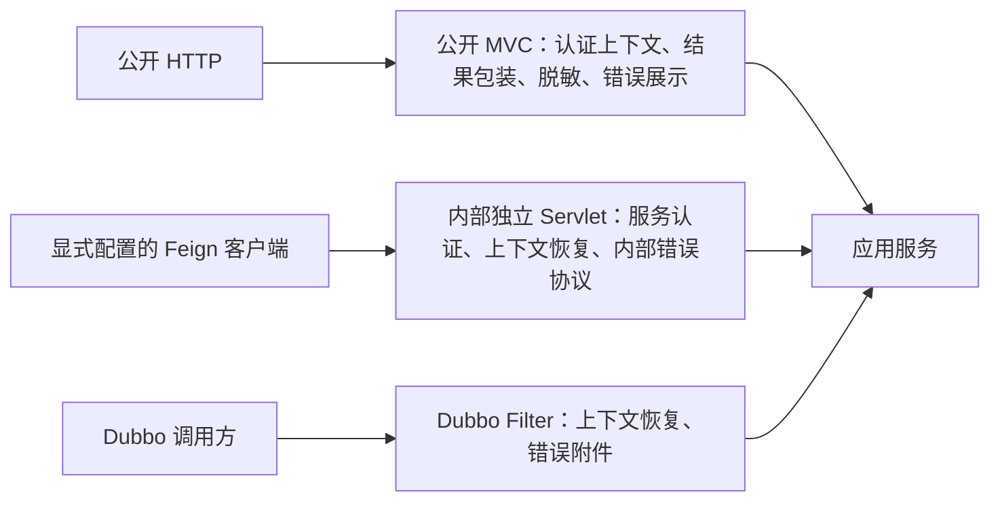
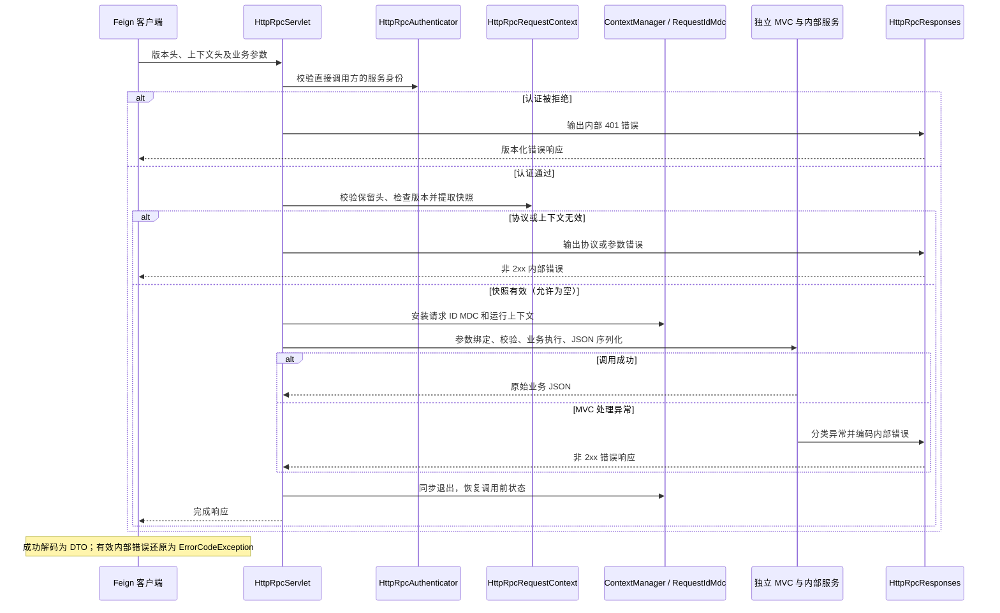
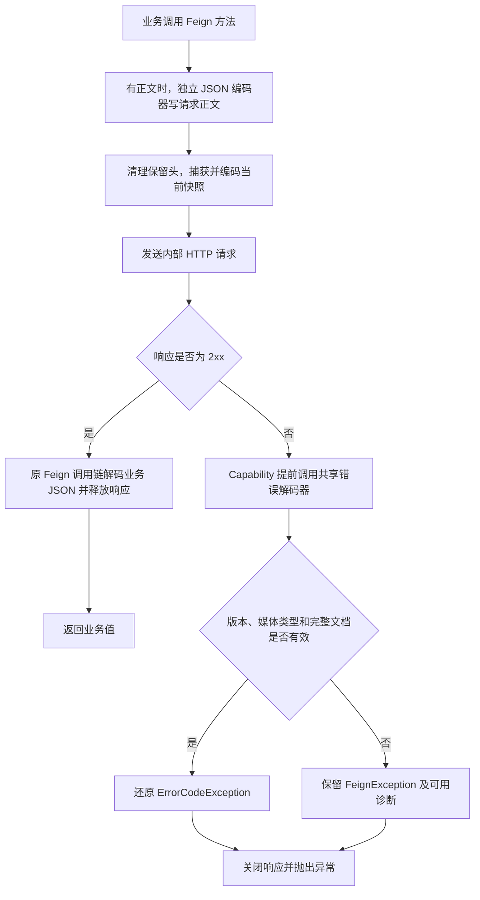

# OpenFeign Service / Client 与 Dubbo 并存指南

HTTP RPC 提供另一条内部调用通道，Dubbo 保留原有调用方式。两套传输适配共用
`ContextManager`、`ContextPropagator`、`ErrorCodeCarrier` 和 `ErrorCodeException`，业务服务不需要依赖传输协议。

## 1. 边界与模块



| 模块 | 职责 |
| --- | --- |
| `wuli3-openfeign-service-spring-boot-starter` | 显式内部服务导出、独立 Servlet/MVC、服务认证、上下文作用域和错误响应。 |
| `wuli3-openfeign-client-spring-boot-starter` | 为指定 Feign 客户端提供上下文注入、独立 JSON 和错误还原。 |
| `wuli3-core-spring-boot-starter` | 统一装配上下文后端、管理器、传播器和 Accessor，供 Web、Dubbo、HTTP RPC 共用。 |

协议实现随调用方向归属两个 starter：client 编码上下文字段并读取错误，service 解码上下文字段并写出错误。
两个 starter 运行时互不依赖，协议兼容性由跨端回归测试验证。

内部 Servlet 使用没有父容器的 MVC 上下文，借用应用容器中已完成依赖注入和代理的服务实例；服务的初始化、销毁仍由应用容器负责。
内部 MVC 有自己的映射器、适配器、参数校验器、JSON converter 和异常解析器，不发现公开 Web 的 advice。
成功结果直接返回业务 JSON，不执行公开响应包装、展示脱敏或资源路径转换。

service starter 的包按职责组织，基包为 `com.kjs.wuli3.openfeign.service`：

| 包 | 内容与边界 |
| --- | --- |
| 基包 | `HttpRpcService`、`HttpRpcAuthenticator`、`HttpRpcProperties`，供应用接入。 |
| `autoconfigure` | 注册 Servlet、收集导出实例并装配公共运行环境。 |
| `mvc` | `HttpRpcServlet`、`HttpRpcHandlerMapping`，管理独立 MVC 和同步调用作用域。 |
| `context` | `HttpRpcRequestContext`，完成请求头校验、版本检查和快照提取，不安装线程状态。 |
| `error` | `HttpRpcResponses`、`HttpRpcErrors`，集中完成异常分类、错误编码和响应输出。 |
| `protocol` | 版本、媒体类型、路径和大小限制等 HTTP 协议常量。 |

调用依赖为 `autoconfigure → mvc → context / error → protocol`；协议常量也供配置属性使用。
这些实现包中的公开类型用于模块内部跨包装配，不作为应用侧扩展接口。
错误输出先完成编码及大小检查再写响应，不经中间内存流；超限时使用有界安全错误，真实编码和输出故障保留原始异常日志。

client starter 同样按职责组织，基包为 `com.kjs.wuli3.openfeign.client`：

| 包 | 内容与边界 |
| --- | --- |
| 基包 | `Wuli3FeignConfiguration` 装配指定客户端；`HttpRpcCapability` 约束方法契约及响应处理顺序。 |
| `context` | `HttpRpcRequestInterceptor` 捕获本地快照、清理保留头并编码出站字段，不修改本地上下文。 |
| `error` | `HttpRpcErrorDecoder` 有界读取、校验完整协议并还原业务错误，其他失败保留传输异常及诊断原因。 |
| `protocol` | 请求及错误响应使用的版本、媒体类型和大小限制。 |

装配入口依赖上下文与错误适配，二者只依赖各自协议及共享运行环境；不使用笼统的 `internal` 包。
错误文档解析是解码器的私有步骤，不再单独暴露 Reader，也不再把已读取的正文包装成输入流后二次读取。
配置将同一个错误解码器同时交给 Feign 和 `HttpRpcCapability`，保证普通错误分支与提前拦截分支遵循同一协议。
应用仍通过 `Wuli3FeignConfiguration` 接入，其余实现类型不作为业务扩展接口。

## 2. 提供端接入

导入仓库 BOM 后添加：

```kotlin
dependencies {
    implementation("com.kjs.wuli3:wuli3-openfeign-service-spring-boot-starter")
}
```

入口默认关闭，显式启用：

```yaml
spring:
  application:
    name: order-service

wuli3:
  http-rpc:
    enabled: true
    path: /internal/rpc
```

`path` 是相对于应用 context path 的独占 Servlet 前缀，不能为根路径、以 `/` 结尾或包含通配符。
内部错误来源服务取 `application.service.service-code`，未配置时回退到 `spring.application.name`。

应用通过 `HttpRpcAuthenticator` Bean 接入服务身份校验。该接口接收
`HttpServletRequest`，返回调用方是否通过校验；应适配已有的工作负载身份、mTLS 或服务令牌验证器。
调用方身份验证发生在解码用户上下文之前，传播的用户 ID、角色、请求 ID 和内部路径均不能作为服务身份证明。
客户端如需服务令牌，可使用该客户端专属的额外 `RequestInterceptor`；该认证头应使用协议保留前缀之外的名称。

服务出口使用 `@HttpRpcService`，将调用委托给现有应用服务：

```java
import com.kjs.wuli3.openfeign.service.HttpRpcService;
import org.springframework.web.bind.annotation.GetMapping;
import org.springframework.web.bind.annotation.PathVariable;

@HttpRpcService
public class OrderRpcEndpoint {
    private final OrderApplicationService orders;

    public OrderRpcEndpoint(final OrderApplicationService orders) {
        this.orders = orders;
    }

    /** 查询订单并返回内部业务数据。 */
    @GetMapping("/orders/{id}")
    public OrderDto find(@PathVariable("id") final String id) {
        return this.orders.find(id);
    }
}
```

上例的实际地址为 `/internal/rpc/orders/{id}`。`OrderApplicationService`、`OrderDto` 由应用定义。
方法支持 Spring 请求映射、参数绑定及 Bean Validation。内部出口不得同时标记
`@Controller` 或 `@RestController`，发现双重标记会使应用启动失败。内部出口如需 AOP，使用类代理；导出的 JDK 动态代理会被明确拒绝。
公开 Controller 和内部出口可分别委托给同一个应用服务。

## 3. 消费端接入

```kotlin
dependencies {
    implementation("com.kjs.wuli3:wuli3-openfeign-client-spring-boot-starter")
}
```

显式指定内部配置及提供端 Servlet 前缀：

```java
import com.kjs.wuli3.openfeign.client.Wuli3FeignConfiguration;
import org.springframework.cloud.openfeign.FeignClient;
import org.springframework.web.bind.annotation.GetMapping;
import org.springframework.web.bind.annotation.PathVariable;

@FeignClient(
        name = "order-rpc",
        url = "${services.order.url}/internal/rpc",
        configuration = Wuli3FeignConfiguration.class)
public interface OrderRpcClient {
    /** 通过内部协议查询订单。 */
    @GetMapping("/orders/{id}")
    OrderDto find(@PathVariable("id") String id);
}
```

在应用配置中使用 `@EnableFeignClients(clients = OrderRpcClient.class)` 注册客户端。
`services.order.url` 配置服务地址，包括部署时的 context path。

`Wuli3FeignConfiguration` 仅用于 `@FeignClient(configuration = ...)`，不要手动导入应用根容器，也不要作为全局默认配置。
其他 Feign 客户端继续使用原有配置。对第三方 HTTP API 或公开 Web 接口的调用也不应套用内部错误协议。
内部客户端返回业务 DTO，拒绝直接返回 `feign.Response`，以免绕过错误恢复；`void` 方法及 `dismiss404` 均不会吞掉内部失败。

## 4. 统一运行环境与错误语义

### 4.1 启动时如何建立隔离

1. `HttpRpcAutoConfiguration` 收集应用容器中标记 `@HttpRpcService` 的已初始化实例，并注册独占路径的 Servlet。
2. `HttpRpcServlet` 创建无父容器的 MVC 上下文，只装配内部映射器、参数校验器、JSON 转换器和异常解析器。
   服务实例保留应用容器完成的依赖注入和 AOP；内部 MVC 不负责再次初始化或销毁这些实例。
3. `HttpRpcHandlerMapping` 发现内部请求映射，并在启动阶段拒绝声明为异步或流式的返回类型。
   Servlet 注册信息声明上下文由其自行管理，使公开 Web 的 `ContextFilter` 跳过这一入口。

仅给路径增加 `/internal` 前缀无法隔离公开 Web 处理；这里的隔离来自独立 Servlet 和无父容器的 MVC 上下文。
应用级全局 Filter 和安全链仍会作用于请求，需要按内部路径配置。

### 4.2 一次同步调用经过哪些步骤



`HttpRpcRequestContext` 只读取请求并构建快照，不操作线程。它先校验所有保留头，再判断协议版本；
版本缺失或不支持时返回空 Optional，版本有效但未传播上下文字段时返回包含空快照的 Optional。
空快照仍需安装，防止当前线程已有的外层身份泄漏进本次调用。

作用域覆盖同步 MVC 调用的参数绑定、业务执行和响应序列化。正常返回或异常退出都会恢复原上下文及 MDC，
恢复的是调用前状态，因此支持已有外层作用域的嵌套。流程图中的 MVC 异常在作用域内处理；
认证、上下文解析或调度时逃逸的异常由 Servlet 外层捕获，此时调用作用域已退出或尚未建立，再尝试内部错误输出。

### 4.3 为什么错误出口单独处理

`HttpRpcResponses` 同时承接 MVC 异常和 Servlet 主动返回的认证、路由等失败。
它将业务异常交给共享 `ErrorResolver`，通过 `ErrorCodePropagator` 编码传播字段；未知异常只在服务端记录原始日志。
先完成整个错误文档的编码和大小检查，再清除未提交的旧正文并写出，避免业务缓冲与错误 JSON 混在一起。
文档超限时生成安全内部错误，替换文档也检查大小；编码或输出 IO 故障保留真实诊断，不当作超限处理。
响应已提交时不能可靠替换正文，异常解析器返回未处理，由上层继续处理原异常。

Servlet 对 `sendError` 的包装也使用这条错误出口，防止容器进入公开 `/error`。
消费端只将版本、媒体类型和文档校验均通过的内部失败还原为 `ErrorCodeException`；其余失败保留为 Feign 异常。

### 4.4 与 Web、Dubbo 共用的运行环境

出站拦截器捕获当前上下文快照，先清除请求中已有的 `X-Wuli3-*` 保留头，再由
`ContextPropagator` 注入允许传播的字段。提供端认证成功后提取快照，在整个同步调用期间安装上下文和
`requestId` MDC；正常完成和抛出异常都会还原调用前的状态。
Web 的 `ContextFilter` 根据容器注册的 Servlet 初始化参数跳过该入口，因此内部上下文不会被公开 Web 再次建立或覆盖。
此判断依据容器元数据，无法通过请求头控制。

应用侧可继续使用 `InvocationContextAccessor`、`AuthContextAccessor`、`ContextManager`。
替换传播器或后端的规则见 [core Spring starter](wuli3-core-spring-boot-starter.md)。扩展字段需在两端使用相同的 codec。
HTTP RPC、Dubbo 混合调用复用同一个上下文和错误契约，传输层只负责各自编码与作用域。

| 结果 | HTTP RPC 行为 |
| --- | --- |
| 成功 | 2xx，直接返回业务 JSON。 |
| `ErrorCodeException` | 非 2xx，传播完整错误字段；消费方还原 `ErrorCodeException`。 |
| 非业务异常 | 提供端记录异常，返回安全的 `HTTP_RPC.INTERNAL_ERROR`，不传原始异常或堆栈。 |
| 认证、路由、绑定、校验等失败 | 使用对应 HTTP 状态及内部协议错误，不进入公开 `/error`。 |
| 非内部协议、损坏或超限的失败响应 | 消费端保留为 Feign 异常；协议解析的 I/O 失败保留在 suppressed 异常中。 |

内部传播保留原始错误码、当前错误码、消息、责任、严重程度、可见性和来源服务，四种可见性均保留完整内容。
消费方再次调用远程服务时保留最初来源；最终抵达公开 Web 出口才执行错误可见性投影和掩码。
业务层仍需按实际责任决定是否覆盖错误归属，直接 RPC 调用方的责任不自动等于最终用户的责任。

### 4.5 客户端的出站与返回流程

构建客户端时，`HttpRpcCapability` 先检查方法契约，拒绝原始 `feign.Response` 返回值。
调用时的流程如下：



Feign 先构造请求模板并编码正文，再执行出站拦截器；没有请求正文的方法跳过 JSON 编码步骤。
出站拦截器只读取当前上下文，不创建新作用域；
应用的服务身份认证头沿用独立拦截器，不能放在被清理的协议保留前缀内。

仅注册 Feign 的 `ErrorDecoder` 无法覆盖 `void`、`dismiss404` 等提前返回分支，
因此 `HttpRpcCapability` 在这些分支之前统一处理非 2xx，成功响应继续交给原调用链。
错误解码器最多读取 64 KiB 加一个字节，并立即关闭读取的输入流；Capability 在失败分支最终关闭外层响应。
JSON 语法错误、重复字段和尾随文档保留为传输失败，解析或读取 IO 原因放入 suppressed 异常；
结构或字段不完整时直接拒绝业务还原，不推测缺失的来源或可见性。

## 5. 协议约束

- 请求版本头为 `X-Wuli3-Rpc-Version: 1`；提供端拒绝缺失或不匹配的版本。
- 上下文头值使用 UTF-8 的无填充 Base64URL，版本头保持明文；单字段最多 4096 个传输字符。拒绝重复字段、非规范编码、非法 UTF-8 和控制字符。
- 失败响应同时携带版本头和 `application/vnd.wuli3.rpc-error+json` 媒体类型，错误正文最多 64 KiB。超限业务错误在提供端回退为安全内部错误。
- 错误文档是 `{"version":"1","error":{...}}`，`error` 中使用现有 `ErrorCodePropagator` 的七个字符串字段，不反序列化业务错误枚举或 Java 异常类。
- 内部 JSON 编解码器独立于公开 Web Mapper；若应用需要额外类型或定制序列化，应先明确两端协议，再扩展适配。

Base64URL 只处理 HTTP 字符约束，不提供加密或身份验证。容器还有请求头总大小限制，部署时应结合实际字段集合配置。

## 6. 当前范围与验证

当前实现面向同步 JSON 接口。声明为 `Callable`、`CompletionStage`、`DeferredResult`、流式或响应式的返回值会在内部映射初始化时被拒绝；不要通过 `Object` 等宽泛类型隐藏异步返回值。
业务自行创建的线程仍需显式传播快照。

独立 Servlet 不隔离应用注册的全局 Filter 和 Spring Security chain；应用需为内部路径配置服务认证策略，避免公开登录流程、响应包装或外部网关路由影响它。
本实现不额外接管注册发现、负载均衡、重试或业务降级；这些行为由应用显式配置。重试须结合业务幂等性确定。
链路追踪沿用现有 OpenTelemetry Agent，此处只维护 Wuli3 上下文及请求 ID MDC。

`HttpRpcProtocolCompatibilityTest` 将 service 的真实状态、响应头和正文交给 client 的完整错误解码器，验证四种可见性和严格解析。
`HttpRpcResponsesTest` 验证超限响应完整替换、清除已有业务缓冲及安全文档本身的大小限制；
`HttpRpcRequestContextTest` 验证上下文编码、重复字段和协议校验顺序。
客户端的 `HttpRpcRequestInterceptorTest` 验证保留头清理、中文编码、本地作用域保持和编码后大小限制；
`HttpRpcErrorDecoderTest` 验证协议标记唯一性、正文大小临界值、输入流关闭及传输异常诊断。
`HttpRpcIntegrationTest` 启动两个真实 HTTP 应用，验证公开包装/脱敏与内部原始 JSON 隔离、中文上下文、线程复用还原、四种错误可见性、最终公开掩码、认证和协议失败、无关 Feign 客户端及双向混合调用。
其中 Dubbo 一跳通过真实 Filter 加本地模拟 Invoker 连接，尚未验证真实 Dubbo 网络、注册中心和独立进程。

```bash
./gradlew :wuli3-core-spring-boot-starter:check \
  :wuli3-web-spring-boot-starter:check \
  :wuli3-dubbo-spring-boot-starter:check \
  :wuli3-openfeign-client-spring-boot-starter:check \
  :wuli3-openfeign-service-spring-boot-starter:check
```

后续接入真实业务前，优先选择一个只读接口，在实际服务身份认证与部署网络下验证 Dubbo、Feign 双通道，并确认已有 Filter/Security 配置符合内部出口契约。
